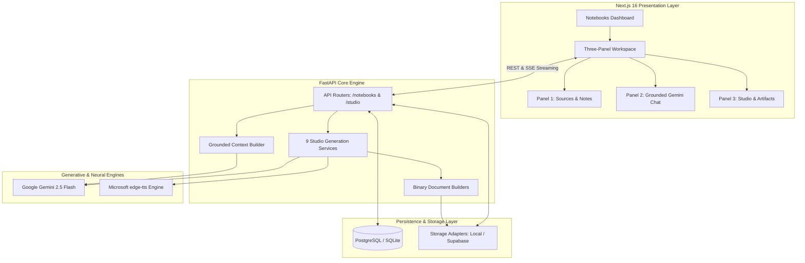
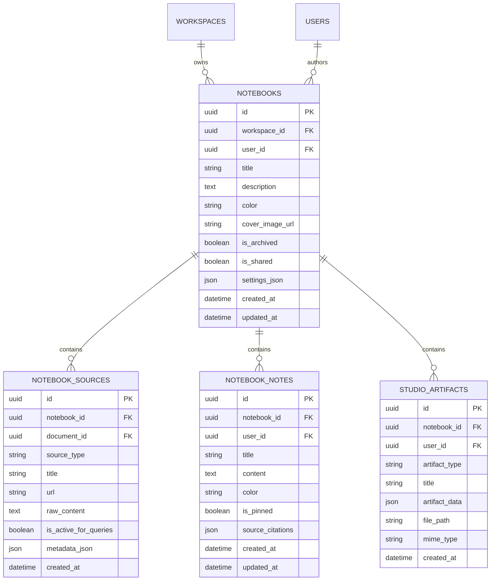

# UDIP — Phase 11 Architectural Design Document

**Platform:** Universal Document Intelligence Platform (UDIP)  
**System:** Gemini NotebookLM-Inspired AI Platform & Studio Engines  
**Date:** November 14, 2026  
**Document Version:** 1.0  
**Architect:** Antigravity Principal AI Systems & Full-Stack Architect  

---

## 1. System Overview

UDIP Phase 11 introduces a high-density, collaborative knowledge workbench inspired by Google Gemini Notebook and NotebookLM. The architecture bridges multi-modal document ingestion, grounded conversational intelligence, and 9 specialized generative engines that synthesize source materials into enterprise-grade artifacts (presentations, reports, audio podcasts, data tables, quizzes, and mind maps).



---

## 2. Three-Panel Desktop Workspace Layout

The core user experience is structured around a non-blocking, three-panel responsive layout:

```
+-------------------+--------------------------------+--------------------+
|  PANEL 1: SOURCES |     PANEL 2: GROUNDED CHAT     |  PANEL 3: STUDIO   |
|  & SAVED NOTES    |                                |  & ARTIFACTS       |
|                   |                                |                    |
| [Add Source +]    | Mode: [Default|Analyst|Guide]  | [Audio Overview]   |
| [x] Document 1    |                                | [Slide Deck]       |
| [x] Website URL   | User: "What is my current..."  | [Mind Map]         |
| [ ] YouTube Video |                                | [Report Generator] |
|                   | AI: "Based on [Source 1]..."   | [Flashcards]       |
| Tabs:             | Citations: [esa_cv.pdf p.1]    | [Quiz Engine]      |
| [Sources] [Notes] |                                | [Infographics]     |
|                   | [Suggested Follow-Up Prompts]  | [Data Tables]      |
| Quick Note editor | [Save Note] [Copy] [Regenerate]| [Video Storyboard] |
+-------------------+--------------------------------+--------------------+
```

### Component Details
1. **Left Panel (Sources & Notes):**
   - Source Management: Multi-type ingestion (Documents, URLs, YouTube videos, Text notes).
   - Dynamic Grounding Selection: Checkboxes allow users to selectively include or exclude individual sources for any specific AI chat query or Studio generation.
   - Notes Drawer: Scratchpad for creating and pinning synthesized insights directly inside the notebook.

2. **Center Panel (Grounded Chat):**
   - Real-Time Streaming: Server-Sent Events (SSE) provide immediate token streaming from Google Gemini (`gemini-2.5-flash`).
   - Grounded Citations: AI claims are attributed with page and passage metadata. Clicking a citation opens the source viewer to that specific page.
   - Persona Modes: Configurable system guidance (Default, Learning Guide, Analyst, Academic, Concise, Detailed).

3. **Right Panel (Studio & Artifacts):**
   - 9 Studio Action Tiles: Instant access to generate audio podcasts, presentations, reports, spreadsheets, quizzes, flashcards, mind maps, infographics, and storyboards.
   - Artifacts History Drawer: Every generated item is persisted with metadata, execution metrics, and one-click binary download.
   - Inline Interactive Viewers: 3D Flip Flashcard player, Interactive Quiz runner, and Mind Map visualizer.

---

## 3. Database Schema & Data Models

Phase 11 introduces 4 relational models strictly partitioned by `workspace_id`:



### Cascade Deletion & Tenant Boundaries
- When a `Notebook` is deleted, all child `NotebookSource`, `NotebookNote`, and `StudioArtifact` records are automatically deleted via database-level `CASCADE`.
- Every query enforces `Notebook.workspace_id == current_workspace.id`, preventing cross-tenant leakage.

---

## 4. Studio Generation Pipelines

Each of the 9 Studio engines inherits from `BaseStudioService`, enforcing structured JSON schema generation and error tolerance:

```
                   +------------------------+
                   |  Selected Active       |
                   |  Notebook Sources      |
                   +-----------+------------+
                               |
                               v
                   +------------------------+
                   | Format Grounded        |
                   | Context & Citations    |
                   +-----------+------------+
                               |
                               v
                   +------------------------+
                   | Gemini 2.5 Flash       |
                   | Strict Schema Prompt   |
                   +-----------+------------+
                               |
                               v
                   +------------------------+
                   | JSON Repair & Parsing  |
                   | (strict=False, commas) |
                   +-----------+------------+
                               |
            +------------------+------------------+
            |                                     |
            v                                     v
  [Structured Data Payload]             [Binary Document Synthesis]
  - Flashcards (JSON)                   - Slide Deck -> python-pptx (.pptx)
  - Quiz Questions (JSON)               - Report Generator -> python-docx (.docx)
  - Mind Map Graph (JSON)               - Data Table -> openpyxl (.xlsx)
  - Infographic Layout (JSON)           - Audio Overview -> edge-tts (.mp3)
  - Video Storyboard (JSON)             |
            |                           v
            |                   [StorageAdapter.save_artifact_file]
            |                           |
            +------------------+--------+
                               |
                               v
                   +------------------------+
                   | Persist StudioArtifact |
                   | to PostgreSQL / SQLite |
                   +------------------------+
```

---

## 5. File Storage Architecture

Artifact file storage is abstracted via `StorageAdapter`:

1. **`LocalStorageAdapter`:**
   - Stores files under `data/storage/{workspace_id}/artifacts/{notebook_id}/{filename}`.
   - Prevents path traversal via strict path normalization and relative root anchoring.
2. **`SupabaseStorageAdapter`:**
   - Uploads binary buffers to Supabase Storage bucket with workspace prefix isolation.
3. **Download Endpoint:**
   - `GET /api/v1/notebooks/{id}/studio/artifacts/{artifact_id}/download` resolves the file path, verifies workspace ownership, and returns a binary stream with proper MIME headers (`Content-Disposition: attachment; filename="..."`).

---

## 6. Multi-Modal Audio Generation Architecture

The Audio Overview engine creates realistic two-host conversational podcasts ("The Deep Dive"):
1. **Dialogue Generation:** Gemini writes a balanced dialogue script between **Alex** (curious, accessible host) and **Sam** (analytical, citation-grounded researcher).
2. **Neural Speech Synthesis:** Dialogue turns are sequentially synthesized using Microsoft neural voices via `edge-tts`:
   - `en-US-GuyNeural` (Alex)
   - `en-US-JennyNeural` (Sam)
3. **Stream Stitching:** Audio frames are concatenated into a standard MP3 stream, written to storage, and linked to the artifact.
