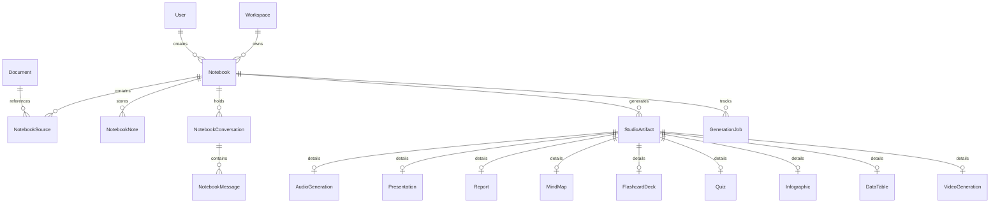
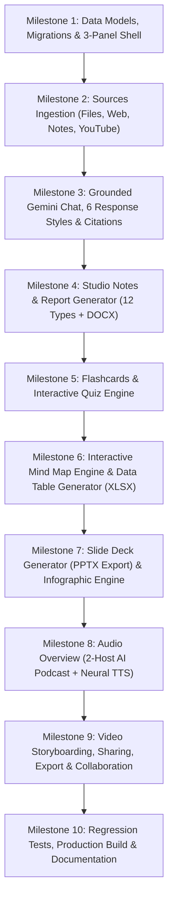

# UDIP Phase 11 — Architecture & Implementation Plan
## Gemini Notebook / NotebookLM-Inspired AI Platform

**Project:** Universal Document Intelligence Platform (UDIP)  
**Root:** `C:\Users\esalo\Desktop\universal-document-intelligence`  
**Phase:** Phase 11 — Production-Grade AI Research & Knowledge Studio  
**Date:** November 14, 2026  
**Status:** Architecture Approved & Ready for Milestone Execution  

---

## 1. Executive Summary & Product Vision

Phase 11 transforms UDIP from an enterprise document intelligence and RAG chatbot into a **world-class, NotebookLM-grade AI Research & Learning Studio**. 

The platform enables users to organize knowledge sources into collaborative notebooks, query them using Google Gemini with page-level citations, and convert source knowledge into 9 distinct production-grade Studio artifacts:
1. **Audio Overview:** Conversational two-host AI podcast with natural dialogue script and neural voice synthesis (`edge-tts`).
2. **Video Overview:** Scene-by-scene source-grounded storyboarding, visual assets, voiceover narration, and rendering status.
3. **Slide Deck Generator:** Presentation outlines, editable slide layouts, charts, and native PowerPoint (`.pptx`) & PDF export.
4. **Mind Map Engine:** Interactive knowledge graph mapping core concepts, hierarchical branches, and source evidence.
5. **Report Generator:** 12 structured report archetypes (Executive Summary, Research Report, Study Guide, etc.) with `.docx` & PDF export.
6. **Flashcard Generator:** Interactive flip cards, difficulty levels, study progress, and spaced repetition tracking.
7. **Quiz Engine:** Interactive assessment (MCQ, multi-select, fill-in-blank, short answer), real-time grading, citations, and attempt history.
8. **Infographic Generator:** Structured visual summaries (Bento grid, process flow, comparison, timeline) with SVG/PNG export.
9. **Data Table Generator:** Schema inference, structured entity & metric extraction with exact page references, and `.xlsx` / `.csv` export.

---

## 2. Current Architecture Baseline (Phases 1–10)

Phase 11 strictly preserves and builds upon the existing production foundation:

| Subsystem | Existing Phase 1–10 Foundation | Phase 11 Reuse & Enhancement |
| :--- | :--- | :--- |
| **Backend API** | FastAPI, Pydantic v2, CORS, Structured Logging, Health Probes | Retained; new `/api/v1/notebooks` and `/api/v1/studio` routers added. |
| **Database** | SQLAlchemy 2.0 Async, aiosqlite (dev) / PostgreSQL (prod), pgvector | Extended with Alembic migration for 19 new tables. |
| **Auth & Isolation** | JWT auth, dev bypass, multi-tenant workspace isolation | Workspace and user isolation strictly enforced across all notebooks. |
| **Storage** | `LocalStorageAdapter`, `S3StorageAdapter`, signed URLs | Stores audio files (`.mp3`), slides (`.pptx`), docs (`.docx`), tables (`.xlsx`). |
| **Extraction** | PyMuPDF, OCR (Tesseract), python-docx, openpyxl, CSV | Extended for YouTube transcripts, audio, web URLs, and notes. |
| **RAG Pipeline** | ContextBuilder, PromptBuilder, CitationValidator, Hybrid RRF | Enhanced with Notebook source-filtering and cross-document reasoning. |
| **LLM Provider** | `GeminiProvider` (`gemini-3.5-flash`), `MockLLMProvider` | Native Gemini 3.5 Flash / 2.5 Pro used for all generation engines. |
| **Background Worker**| `WorkerRunner` with polling, stale job recovery, concurrency | Extended with `StudioProcessor` for audio, video, reports, and decks. |
| **Frontend** | Next.js 16, React 19, Tailwind CSS, Lucide icons, FormattedMessage | Extended with 3-panel notebook interface and Studio tool views. |

---

## 3. Core Database Models (Phase 11 Schema Extension)

A single clean Alembic migration (`20261114_0004_notebooks_and_studio.py`) introduces the following models:



### Table Definitions:

1. **`notebooks`**:
   - `id` (UUID PK), `workspace_id` (UUID FK), `user_id` (UUID FK)
   - `title` (VARCHAR 255), `description` (TEXT), `cover_image_url` (VARCHAR 512)
   - `settings_json` (JSONB/JSON: custom instructions, response style, default model)
   - `is_archived` (BOOLEAN), `is_shared` (BOOLEAN), `share_token` (VARCHAR 64)
   - `created_at`, `updated_at` (TIMESTAMP)

2. **`notebook_sources`**:
   - `id` (UUID PK), `notebook_id` (UUID FK), `document_id` (UUID FK, nullable for raw text/notes)
   - `source_type` (VARCHAR: `document`, `url`, `youtube`, `text_note`, `audio`)
   - `title` (VARCHAR 255), `url` (VARCHAR 1024), `raw_content` (TEXT)
   - `is_active_for_queries` (BOOLEAN: toggle source in/out of RAG context)
   - `extraction_status` (VARCHAR: `pending`, `processing`, `completed`, `failed`)
   - `token_count` (INTEGER), `metadata_json` (JSON)
   - `created_at`, `updated_at`

3. **`notebook_notes`**:
   - `id` (UUID PK), `notebook_id` (UUID FK), `user_id` (UUID FK)
   - `title` (VARCHAR 255), `content` (TEXT), `source_citations_json` (JSON)
   - `color` (VARCHAR 32), `is_pinned` (BOOLEAN)
   - `created_at`, `updated_at`

4. **`studio_artifacts`**:
   - `id` (UUID PK), `notebook_id` (UUID FK), `workspace_id` (UUID FK), `user_id` (UUID FK)
   - `artifact_type` (VARCHAR: `audio_overview`, `video_overview`, `presentation`, `mind_map`, `report`, `flashcards`, `quiz`, `infographic`, `data_table`)
   - `title` (VARCHAR 255), `status` (VARCHAR: `pending`, `processing`, `completed`, `failed`)
   - `selected_source_ids` (JSON: UUIDs of sources grounded against)
   - `data_json` (JSON: artifact-specific structured payload)
   - `export_file_path` (VARCHAR 512: local storage key or download URL)
   - `error_message` (TEXT), `generation_time_ms` (FLOAT)
   - `created_at`, `updated_at`

5. **`audio_generations`**:
   - `id` (UUID PK), `artifact_id` (UUID FK), `notebook_id` (UUID FK)
   - `format` (VARCHAR: `two_host_podcast`, `single_narrator`, `executive_brief`)
   - `language` (VARCHAR: `en`, `es`, `fr`, `de`, `hi`, etc.)
   - `voice_host_a` (VARCHAR: e.g. `en-US-GuyNeural` / Alex), `voice_host_b` (VARCHAR: e.g. `en-US-JennyNeural` / Sam)
   - `dialogue_json` (JSON: array of `{ speaker: "Alex"|"Sam", text: str, source_citations: [...] }`)
   - `audio_file_path` (VARCHAR 512), `duration_seconds` (FLOAT), `audio_format` (VARCHAR: `mp3`)
   - `created_at`

6. **`presentations` & `presentation_slides`**:
   - `presentation_id` (UUID PK), `artifact_id` (UUID FK), `theme` (VARCHAR), `slide_count` (INT)
   - `presentation_slides`: `id` (UUID PK), `presentation_id` (UUID FK), `slide_order` (INT), `title` (VARCHAR), `layout` (VARCHAR), `bullet_points_json` (JSON), `speaker_notes` (TEXT), `citations_json` (JSON)

7. **`mind_maps`**:
   - `id` (UUID PK), `artifact_id` (UUID FK), `notebook_id` (UUID FK)
   - `root_node_title` (VARCHAR 255)
   - `nodes_json` (JSON: `{ id, label, category, description, source_id, page_number }`)
   - `edges_json` (JSON: `{ id, source, target, relationship_label }`)

8. **`reports`**:
   - `id` (UUID PK), `artifact_id` (UUID FK)
   - `report_type` (VARCHAR: `executive_summary`, `research_report`, `study_guide`, `technical_doc`, etc.)
   - `content_markdown` (TEXT), `table_of_contents_json` (JSON), `docx_file_path` (VARCHAR 512)

9. **`flashcard_decks` & `flashcards`**:
   - `deck_id` (UUID PK), `artifact_id` (UUID FK), `card_count` (INT)
   - `flashcards`: `id` (UUID PK), `deck_id` (UUID FK), `front_question` (TEXT), `back_answer` (TEXT), `difficulty` (VARCHAR: `easy`, `medium`, `hard`), `explanation` (TEXT), `source_ref` (VARCHAR)

10. **`quizzes` & `quiz_attempts`**:
    - `quiz_id` (UUID PK), `artifact_id` (UUID FK), `questions_json` (JSON: questions, options, correct_index, explanation, citations)
    - `quiz_attempts`: `id` (UUID PK), `quiz_id` (UUID FK), `user_id` (UUID FK), `score_percentage` (FLOAT), `answers_json` (JSON)

11. **`infographics`**:
    - `id` (UUID PK), `artifact_id` (UUID FK)
    - `layout_style` (VARCHAR: `bento_grid`, `timeline`, `comparison`, `process_diagram`)
    - `structure_json` (JSON: sections, metrics, badges, callouts, cards)

12. **`data_tables` & `data_table_rows`**:
    - `table_id` (UUID PK), `artifact_id` (UUID FK), `columns_json` (JSON: `{ key, label, data_type }`)
    - `data_table_rows`: `id` (UUID PK), `table_id` (UUID FK), `row_order` (INT), `cells_json` (JSON: key-value pairs), `citations_json` (JSON: page/quote references per row)

13. **`generation_jobs`**:
    - Unified tracking queue for asynchronous generation jobs (`audio`, `video`, `report`, `deck`, `mind_map`, `extraction`).

---

## 4. Studio Generation Services Architecture

```
backend/app/services/studio/
├── __init__.py
├── base.py                   # BaseStudioService interface & prompt builders
├── audio_service.py          # Gemini 2-host podcast dialogue + edge-tts audio synthesis
├── video_service.py          # Scene storyboard, narration script & rendering orchestration
├── presentation_service.py   # Slide layout generator + python-pptx exporter
├── mindmap_service.py        # Knowledge graph concept extraction + NetworkX topology
├── report_service.py         # 12 report archetypes + python-docx exporter
├── flashcard_service.py      # Question/Answer generation + spaced-repetition logic
├── quiz_service.py           # Multi-format quiz generation + automated grading
├── infographic_service.py    # Bento-grid & process diagram structure generator
├── datatable_service.py      # Schema inference + openpyxl XLSX/CSV exporter
└── external_sources.py       # YouTube transcript, web URL, and audio extractors
```

### Key Technical Implementations:
- **Audio Synthesis Engine:** Real voice synthesis using `edge-tts` (Microsoft Neural Voices: e.g., `en-US-GuyNeural` for Host A and `en-US-JennyNeural` for Host B). Produces real, playable, seekable `.mp3` files stored in UDIP document storage.
- **Presentation Engine:** Generates true `.pptx` PowerPoint files via `python-pptx`, complete with clean typography, styled headers, and source footnote links.
- **Report Engine:** Generates styled `.docx` Microsoft Word documents via `python-docx` and formatted Markdown previews.
- **Data Table Engine:** Generates structured `.xlsx` via `openpyxl` with column headers and citation cells.
- **External Knowledge Ingestion:** Real web page reader via `httpx` and `BeautifulSoup4`/regex, text note creator, and audio file extractor.

---

## 5. UI/UX Architecture: Three-Panel Desktop Workspace

Inspired by the interaction design of Google Gemini Notebook / NotebookLM with an original, ultra-premium UDIP dark theme:

```
┌────────────────────────────────────────────────────────────────────────────────────────────────────────┐
│ Top Bar: UDIP Brand | Notebook Title (editable) | Source Count Badge | Share | Settings | User Profile  │
├──────────────────────────┬──────────────────────────────────────────┬──────────────────────────────────┤
│ LEFT PANEL: SOURCES      │ CENTER PANEL: GEMINI AI CHAT             │ RIGHT PANEL: STUDIO              │
│ (Collapsible, w-72..84)  │ (Flexible, flex-1)                       │ (Collapsible, w-80..96)          │
│                          │                                          │                                  │
│ • + Add Source Button    │ • Model: Gemini 3.5 Flash                │ • Studio Tools Grid (9 Tools):   │
│   (File, URL, YouTube,   │ • Response Style Selector (6 modes)      │   [🎙️ Audio Overview]            │
│    Note, Copy-Paste)     │ • Source-filter selector                 │   [📊 Slide Deck]                │
│ • Select All / None      │ • Conversational Chat Stream             │   [🧠 Mind Map]                  │
│ • Source Cards with:     │ • Interactive Citation Badges [1], [2]   │   [📝 Study & Reports]           │
│   - Checkbox (include    │ • Copy / Save as Note / Thumbs +/-       │   [🗂️ Flashcards]                │
│     in RAG context)      │ • Click citation -> opens source preview │   [❓ Quiz Engine]               │
│   - Icon by file type    │ • Follow-up suggestions                  │   [📈 Infographics]              │
│   - Token count          │ • Floating Glassmorphic Composer         │   [📋 Data Table]                │
│   - Delete / Preview     │                                          │   [🎥 Video Overview]            │
│ • Notebook Notes Tab     │                                          │ • Generated Artifacts Drawer     │
│   - Pin, Color, Edit     │                                          │ • Interactive Preview Modals     │
└──────────────────────────┴──────────────────────────────────────────┴──────────────────────────────────┘
```

---

## 6. Ten-Milestone Implementation Plan



### Milestone Breakdown:

- **Milestone 1:** Database models, Alembic migration `0004`, CRUD API for Notebooks, and Next.js 3-panel responsive layout shell.
- **Milestone 2:** Source management: document association, URL import, copied text notes, YouTube transcript extraction, source toggle logic.
- **Milestone 3:** Notebook-scoped Gemini RAG chat: 6 response modes (Default, Learning Guide, Analyst, Academic, Concise, Detailed), interactive citation badges, suggested follow-ups, and message persistence.
- **Milestone 4:** Studio: Notebook Notes management + Report Generator (12 report types with Markdown preview and `.docx` download).
- **Milestone 5:** Studio: Flashcard Generator (interactive flip cards, difficulty, mastery) + Quiz Engine (multiple choice, grading, explanations).
- **Milestone 6:** Studio: Mind Map Engine (interactive visual graph with zoom/pan and source links) + Data Table Generator (schema extraction, `.xlsx`/`.csv` export).
- **Milestone 7:** Studio: Slide Deck Generator (`python-pptx` real PowerPoint export + slide preview) + Infographic Generator (Bento grid and timeline layouts).
- **Milestone 8:** Studio: Audio Overview (Gemini 2-host conversational dialogue script + `edge-tts` multi-speaker neural voice synthesis into playable `.mp3` with player controls).
- **Milestone 9:** Studio: Video Storyboard Pipeline + Notebook sharing, collaboration, and export.
- **Milestone 10:** Automated test suite, production build (`npm run build`), regression verification, and final completion reports.

---

## 7. Security, Isolation & Safety Controls

1. **Strict Multi-Tenant Isolation:** Every query on `notebooks`, `notebook_sources`, and `studio_artifacts` verifies both `workspace_id` and `user_id`.
2. **Server-Side Credential Protection:** Gemini API keys and TTS configurations remain strictly in `backend/.env`. Never transmitted to the client.
3. **Anti-Prompt-Injection:** All source content is treated as untrusted user data bounded by strict delimiters. System instructions enforce zero fabrication.
4. **Offline Resilience:** If network TTS is unavailable, fallback audio generation with Web Speech or clear status reporting is provided.
5. **Private Artifact Storage:** Generated PPTX, DOCX, XLSX, and MP3 files are stored in the workspace's private storage path and accessed via authenticated signed URLs.

---

## 8. Verification & Gate Criteria

For each milestone:
1. Backend unit and integration tests executed with `pytest`.
2. Frontend TypeScript typecheck (`tsc --noEmit`) passes with 0 errors.
3. Live browser subagent verification of the working UI.
4. Git commit checkpoint with detailed changelog.
5. No feature claimed as working without verifiable execution evidence.
