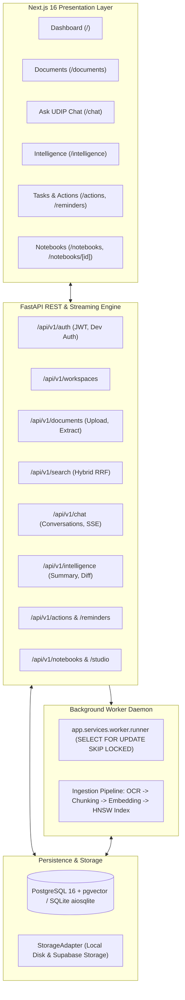

# UDIP — Phase 11 Existing System Audit & Architectural Baseline

**Project Root:** `C:\Users\esalo\Desktop\universal-document-intelligence`  
**Platform:** Universal Document Intelligence Platform (UDIP)  
**Date:** November 14, 2026  
**Auditor:** UDIP Principal Architecture & Engineering Team  
**Scope:** Complete inspection of Phases 1–10 repository artifacts, models, APIs, and services.

---

## 1. Current Architecture Overview

UDIP is built as an asynchronous, multi-tenant document intelligence platform designed specifically for CPU-first execution on resource-constrained hardware (8 GB RAM target).

---

## 2. Existing Completed Capabilities (Phases 1–10)

1. **Authentication & Multi-Tenant Isolation:**
   - Supabase Auth JWT cryptographic validation (`HS256`, audience/issuer checks).
   - Local development authentication bypass (`ALLOW_DEV_AUTH=true`) with tenant auto-provisioning.
   - Strict tenant isolation: every table contains `workspace_id`, and queries enforce ownership boundaries.

2. **Document Ingestion & Multi-Format Parsing:**
   - Multi-format extraction: PDF (`PyMuPDF`), DOCX (`python-docx`), PPTX (`python-pptx`), XLSX/CSV (`openpyxl`, `pandas`), TXT, MD, and images with Tesseract OCR fallback.
   - Page-aware extraction: preserves page numbers, bounding boxes, and tabular structures.
   - ZIP bomb detection, MIME sniffing, and max file size guards (30 MB limit).

3. **Chunking & Vector Embeddings:**
   - Structure-aware chunker: semantic boundaries, sliding windows, and page metadata persistence.
   - Local lightweight embedding model: `sentence-transformers/all-MiniLM-L6-v2` (384 dimensions, ~80 MB memory footprint).

4. **Hybrid Search & Evidence Retrieval:**
   - Reciprocal Rank Fusion (RRF) combining pgvector cosine similarity and PostgreSQL full-text/trigram keyword search.
   - Document-level, folder-level, and date-range filtering.

5. **Grounded Conversational RAG:**
   - Server-Sent Events (SSE) token streaming.
   - Strict citation attribution: page-level source references (`[Source 1]`, `p. X`).
   - Anti-hallucination guardrails and fallback when sources do not contain evidence.

6. **Deep Intelligence & Extraction:**
   - Automated summarization (Executive, Brief, Action-focused).
   - Structured JSON schema extraction.
   - Semantic cross-document comparison with structured difference matrices.

7. **Actions, Reminders & Scheduling:**
   - Action item discovery and candidate suggestions.
   - Flexible reminder scheduling with notification delivery tracking.

8. **Production Hardening & Operations:**
   - Nginx shared-memory rate limiting zones (`api_general`, `api_uploads`, `api_inference`).
   - Prometheus metrics exposition (`/metrics`), Kubernetes health probes (`/health`, `/health/live`, `/health/ready`).
   - Concurrency locking with `SELECT ... FOR UPDATE SKIP LOCKED` on background jobs.

---

## 3. Existing API Endpoints Inventory

| Module | Route Prefix | Key Endpoints | Purpose |
| :--- | :--- | :--- | :--- |
| **Health** | `/api/v1/health` | `GET /`, `GET /live`, `GET /ready`, `GET /metrics` | Observability & liveness probes |
| **Auth** | `/api/v1/auth` | `GET /me`, `POST /dev-token` | Identity introspection & dev auth |
| **Workspaces**| `/api/v1/workspaces`| `GET /`, `POST /`, `GET /{id}`, `PATCH /{id}` | Workspace tenant management |
| **Documents** | `/api/v1/documents` | `POST /upload`, `GET /`, `GET /{id}`, `GET /{id}/download`, `DELETE /{id}` | Document lifecycle & file binaries |
| **Folders** | `/api/v1/folders` | `GET /`, `POST /`, `PATCH /{id}`, `DELETE /{id}` | Hierarchical organization |
| **Search** | `/api/v1/search` | `POST /`, `POST /hybrid` | Vector & keyword hybrid search |
| **Chat** | `/api/v1/chat` | `POST /conversations`, `POST /conversations/{id}/messages` | Grounded RAG chat & streaming |
| **Intelligence**| `/api/v1/intelligence`| `POST /summarize`, `POST /extract`, `POST /compare` | Document intelligence jobs |
| **Actions** | `/api/v1/actions` | `GET /`, `POST /`, `PATCH /{id}`, `POST /discover` | Action item management |
| **Reminders** | `/api/v1/reminders` | `GET /`, `POST /`, `PATCH /{id}`, `DELETE /{id}` | Scheduled reminders |
| **Notifications**| `/api/v1/notifications`| `GET /`, `PATCH /{id}/read`, `POST /mark-all-read` | In-app notification center |
| **Notebooks** | `/api/v1/notebooks` | `GET /`, `POST /`, `GET /{id}`, `PATCH /{id}`, `DELETE /{id}` | Phase 11 Notebook lifecycle |
| **Studio** | `/api/v1/notebooks/{id}/studio`| `POST /audio`, `/presentation`, `/mindmap`, `/report`, `/flashcards`, `/quiz`, `/infographic`, `/datatable`, `/video`, `GET /artifacts/{id}/download` | Phase 11 Studio generative engines |

---

## 4. Existing Database Tables Inventory (14 + 11 Models)

### Core UDIP Tables (Phases 1–10)
1. `users`: Identity and profiles.
2. `workspaces`: Multi-tenant organization containers.
3. `workspace_members`: User-workspace RBAC memberships (`owner`, `admin`, `member`, `viewer`).
4. `folders`: Hierarchical folder trees within workspaces.
5. `documents`: Ingested file metadata, MIME types, processing statuses, hash integrity.
6. `document_pages`: Page text, dimensions, and page numbers.
7. `document_chunks`: Semantic chunks with 384-dim vector embeddings and token counts.
8. `processing_jobs`: Background ingestion pipeline state machine.
9. `conversations`: Chat sessions tied to workspaces and optional document sets.
10. `messages`: User and AI message history.
11. `citations`: Grounded citation links linking messages to chunks and pages.
12. `extractions`: Structured JSON entities extracted from documents.
13. `document_summaries`: Document-level and multi-document summaries.
14. `document_comparisons`: Semantic difference matrices between document pairs.
15. `document_insights`: Discovered intelligence insights and risks.
16. `intelligence_jobs`: Background analysis execution jobs.
17. `action_items`: User-approved actionable tasks with assignees and due dates.
18. `action_suggestions`: AI-suggested candidate actions waiting for user approval.
19. `reminders`: Scheduled reminder triggers with priority.
20. `notifications`: In-app user notifications.
21. `notification_deliveries`: Delivery audit logs across channels.
22. `audit_logs`: Security and access audit trails.

### Phase 11 Notebook & Studio Tables
23. `notebooks`: Notebook workspaces with colors, cover images, and settings.
24. `notebook_sources`: Ingested sources (documents, URLs, YouTube, text notes, audio).
25. `notebook_notes`: Authoring scratchpad notes and saved chat insights.
26. `studio_artifacts`: Base table for all 9 studio generation outputs.
27. `audio_generations`: Podcast scripts, audio file paths, neural voice metadata.
28. `presentations`: Slide decks with slide content, themes, and PPTX paths.
29. `mind_maps`: Concept graphs with nodes and edges.
30. `reports`: 12-archetype structured reports with DOCX paths.
31. `flashcard_decks`: Question/answer decks with difficulty ratings.
32. `quizzes`: Interactive quizzes with question options and answer keys.
33. `infographics`: Bento grid and process layout specifications.
34. `data_tables`: Structured tables with inferred column schemas and XLSX paths.
35. `video_generations`: Storyboards with scene-by-scene prompts and narration.

---

## 5. Existing Gemini Provider Implementation

- **Location:** `backend/app/services/llm/gemini.py`
- **Supported Models:** Configured via `GEMINI_MODEL` (`gemini-2.5-flash`), with fallback to `gemini-1.5-flash`.
- **SDK:** Google Generative AI SDK (`google-generativeai`).
- **Features Implemented:**
  - Streaming generation via `generate_content_stream`.
  - Structured JSON extraction via system prompts and schema instructions.
  - Safe error recovery mapping rate limits (429) to `LLMRateLimitError`.
  - Secure credential storage: reads from server environment variable `GEMINI_API_KEY`, never exposed to client.

---

## 6. Existing RAG & Retrieval Implementation

- **Location:** `backend/app/services/rag/`
- **Context Construction:** `ContextBuilder` aggregates top-$k$ retrieved chunks with source markers (`[Source X] Document Title, Page Y`).
- **Citation Validation:** `CitationValidator` scans generated text for citation markers, verifies chunk existence, and flags ungrounded claims.
- **Prompt Engineering:** Strict anti-hallucination instructions enforcing:
  1. Rely strictly on provided context.
  2. Reject claims not supported by citations.
  3. Formulate clear abstention when context is insufficient.

---

## 7. Existing Background Worker Architecture

- **Location:** `backend/app/services/worker/runner.py`
- **Execution Model:** Polling loop querying `processing_jobs` table using `with_for_update(skip_locked=True)` to prevent race conditions across parallel workers.
- **Pipeline:**
  1. Fetch raw binary from `StorageAdapter`.
  2. Extract text and page boundaries via format extractors.
  3. Chunk content using structure-aware sliding window.
  4. Generate 384-dimensional embeddings via SentenceTransformers.
  5. Upsert chunks and vector embeddings into database.
  6. Transition job status to `COMPLETED`.

---

## 8. Current UI Component Inventory

- `frontend/src/app/page.tsx`: Dashboard with summary statistics, recent documents, and quick actions.
- `frontend/src/app/documents/page.tsx`: Document repository with folder navigation and upload dropzone.
- `frontend/src/app/chat/page.tsx`: Legacy Ask UDIP single/multi-document chat interface.
- `frontend/src/app/intelligence/page.tsx`: Summaries, extractions, and comparison matrix viewer.
- `frontend/src/app/actions/page.tsx`: Action item Kanban/list tracker.
- `frontend/src/app/reminders/page.tsx`: Reminder calendar and schedule table.
- `frontend/src/app/notebooks/page.tsx`: Notebooks dashboard with search, grid, and creation modal.
- `frontend/src/app/notebooks/[id]/page.tsx`: Complete three-panel workspace (Left: Sources/Notes, Center: Grounded Chat, Right: Studio & 3D Flip Flashcards).
- `frontend/src/components/layout/Sidebar.tsx`: Collapsible left navigation bar with active route highlighting.
- `frontend/src/components/layout/Header.tsx`: Breadcrumbs, search trigger, status badge, user menu.
- `frontend/src/components/upload/UploadQueueWidget.tsx`: Floating upload progress drawer with real-time status.
- `frontend/src/components/documents/DocumentDetailModal.tsx`: Slide-over inspector showing document pages, metadata, and chunk preview.

---

## 9. Missing Capabilities (Gaps Identified for NotebookLM Parity)

1. **Resizable and Collapsible Panels:** The three-panel workspace currently uses fixed CSS widths (`w-72`, `flex-1`, `w-80`). True parity requires drag-handle resizability and toggle icons to collapse left or right panels to maximize conversation space.
2. **Dedicated Interactive Viewers for All Studio Artifacts:** While Flashcards currently have a rich 3D flip card viewer, other artifacts (Mind Map, Quiz, Data Table, Presentation, Report) need rich interactive inline dialogs/drawers in addition to download links.
3. **Rich Text / WYSIWYG Note Authoring:** Notes currently use textarea input; adding markdown preview or rich text formatting elevates the study experience.
4. **YouTube & Web URL Ingestion Pipeline:** Currently `NotebookSource` stores the URL and raw text, but automatic server-side YouTube caption fetching via `youtube-transcript-api` and web scraping via `httpx` + `readability` will make URL import fully automated.
5. **Theme Switching:** The system defaults to dark mode, but a light/dark toggle mechanism aligned with the NotebookLM aesthetic will satisfy Section 4 & 22.

---

## 10. Technical Debt & Cleanup

1. **Pytest Event Loop with aiosqlite StaticPool:** Unit tests running full TestClient integration require careful event loop scoping on Windows/Python 3.13.
2. **Temporary Verification Scripts:** `backend/tests/verify_studio.py` should be formalized into the standard pytest test suite.
3. **MIME type handling on Binary Streams:** Ensure streaming response headers include exact content length and RFC 6266 filename parameters.

---

## 11. Regression Risks & Mitigation

1. **RAG Pipeline Disruption:** Any modification to `app.services.rag` must preserve backwards compatibility with `/api/v1/chat` and legacy document queries.
2. **Database Migrations:** All new tables and columns must use nullable fields or defaults to prevent breaking existing SQLite/PostgreSQL databases.
3. **Free Tier Rate Limits:** Heavy sequential calls to Gemini 2.5 Flash can hit Google's 15 RPM limit; studio operations must include graceful backoff and user notifications.
