# UDIP — Phase 11 Implementation Plan: Complete AI NotebookLM-Style Product

**Platform:** Universal Document Intelligence Platform (UDIP)  
**Target:** 12-Milestone Production Rollout Plan  
**Date:** November 14, 2026  
**Document Version:** 1.0  
**Architect:** UDIP Principal Engineering & DevOps Team  

---

## 1. Implementation Roadmap & Milestones

This document details the sequential execution roadmap for delivering complete functional parity with Google NotebookLM across all 12 requested milestones.

```mermaid
flowchart LR
    M1[M1: Audit & Reference] --> M2[M2: 3-Panel Layout]
    M2 --> M3[M3: Source Ingestion]
    M3 --> M4[M4: Grounded Chat]
    M4 --> M5[M5: Notes & Reports]
    M5 --> M6[M6: Flashcards & Quizzes]
    M6 --> M7[M7: Mind Maps & Tables]
    M7 --> M8[M8: Slides & Infographics]
    M8 --> M9[M9: Audio Podcast]
    M9 --> M10[M10: Video Storyboard]
    M10 --> M11[M11: Sharing & Collab]
    M11 --> M12[M12: Hardening & Testing]
```

---

## 2. Milestone-by-Milestone Execution Matrix

### Milestone 1: Reference Analysis, Architecture Audit & Visual Design System
- **Goals:** Inspect existing codebase, test REA/browser automation connectivity, inspect reference URL, establish design system tokens.
- **Deliverables:** `PHASE_11_EXISTING_SYSTEM_AUDIT.md`, `PHASE_11_REFERENCE_RESEARCH.md`, `PHASE_11_UI_REFERENCE_CATALOG.md`, `PHASE_11_INTERACTION_MAP.md`.
- **Verification:** 100% verified against repository models, routers, and safety boundaries.

### Milestone 2: Three-Panel Notebook Layout & Dashboard
- **Goals:** Build high-performance desktop shell with three distinct panels: Sources (Left), Grounded Chat (Center), Studio (Right).
- **Backend:** `Notebook` CRUD endpoints (`/api/v1/notebooks`), color tags, description metadata.
- **Frontend:** `/notebooks` dashboard page and dynamic route `/notebooks/[id]`.
- **Verification:** Browser subagent verified navigation, dashboard cards, and 3-panel shell rendering.

### Milestone 3: Source Management & Processing
- **Goals:** Ingestion of multiple formats (PDF, DOCX, XLSX, TXT, Web URLs, YouTube links, Text notes).
- **Backend:** `NotebookSource` table, source toggle endpoint (`PATCH /api/v1/notebooks/{id}/sources/{source_id}`).
- **Frontend:** Left panel with Add Source modal, tabs for document upload, web URL, YouTube link, and text note.
- **Verification:** Sources listed with active checkboxes, status badges, and token counts.

### Milestone 4: Gemini Chat, Streaming, RAG & Citations
- **Goals:** Server-Sent Events (SSE) streaming chat backed by Google Gemini (`gemini-2.5-flash`), with exact source citations and 6 response modes.
- **Backend:** Integration with `ContextBuilder` and `CitationValidator` in `backend/app/services/rag/`.
- **Frontend:** Formatted markdown message bubbles, clickable citation pills opening document viewer, follow-up prompt pills.
- **Verification:** Verified live streaming query: *"What is my name and current title according to my CV?"* $\to$ Name: Mohammad Esa Loni, Title: Data Analyst, citing `esa_cv (2).pdf Page 1`.

### Milestone 5: Notes & Reports
- **Goals:** Authoring notes, saving chat responses to notes, and generating 12 report archetypes with Word (`.docx`) export.
- **Backend:** `NotebookNote` table, `ReportService` using `python-docx` with styled corporate templates.
- **Frontend:** Notes tab in left panel, "Save as Note" action in chat, Report Generator studio modal.
- **Verification:** Generated 6-section Executive Profile report; verified `.docx` binary generation (38,069 bytes).

### Milestone 6: Flashcards & Quizzes
- **Goals:** Interactive study tools with question extraction, difficulty classification, and assessment.
- **Backend:** `FlashcardService` and `QuizService` returning structured JSON schemas with citations.
- **Frontend:** Interactive 3D flip-card deck with "Got It" and "Missed It" tracking; Interactive quiz runner with option grading and explanations.
- **Verification:** Generated 4 flashcards and 3-question quiz; verified 3D flip card interaction in live browser.

### Milestone 7: Mind Maps & Data Tables
- **Goals:** Knowledge graph extraction and structured tabular matrix extraction with Excel (`.xlsx`) export.
- **Backend:** `MindMapService` (nodes & edges) and `DataTableService` using `openpyxl` with dynamic column schemas.
- **Frontend:** Interactive mind map visualizer; sortable data table with one-click Excel download.
- **Verification:** Generated 14-node Mind Map; generated 6-column Data Table and verified `.xlsx` download (6,002 bytes).

### Milestone 8: Slides & Infographics
- **Goals:** Automated presentation outlines with PowerPoint (`.pptx`) export and visual Bento grid infographics.
- **Backend:** `PresentationService` using `python-pptx` with slide titles, bullets, and speaker notes; `InfographicService`.
- **Frontend:** Presentation preview card with PPTX download; Bento grid layout with KPI callout metrics.
- **Verification:** Generated 4-slide presentation and verified `.pptx` download (30,551 bytes).

### Milestone 9: Audio Generation (Podcast Engine)
- **Goals:** Two-host conversational podcast ("The Deep Dive") generated from notebook sources.
- **Backend:** `AudioOverviewService` using Gemini for natural dialogue script and Microsoft neural voices via `edge-tts` (Alex & Sam).
- **Frontend:** Persistent audio player with play/pause, scrub bar, playback speed selector ($1\times$–$2\times$), and download button.
- **Verification:** Verified audio pipeline and `.mp3` storage adapter integration.

### Milestone 10: Video Generation (Storyboard Director)
- **Goals:** Scene-by-scene video director storyboard with camera directions, visual generation prompts, and narration scripts.
- **Backend:** `VideoOverviewService` with structured scene breakdown and estimated scene timings.
- **Frontend:** Storyboard drawer displaying scene cards, camera angles, visual prompts, and voiceover scripts.
- **Verification:** Verified multi-scene storyboard generation and persistence to `StudioArtifact`.

### Milestone 11: Sharing, Collaboration & Advanced Settings
- **Goals:** Multi-user notebook sharing, public read-only links, workspace isolation, and custom model instructions.
- **Backend:** `share_token` generation on `Notebook`, workspace foreign key enforcement, tenant boundary validation.
- **Frontend:** Share modal, custom prompt instructions modal, notebook color customization.
- **Verification:** Verified cross-workspace authorization isolation (403/404 on foreign tenant requests).

### Milestone 12: Full Integration, Security, Regression & Performance Testing
- **Goals:** Run end-to-end integration tests, verify TypeScript builds, validate memory usage under 8 GB RAM.
- **Verification:** Executed unit tests (`test_presentation_service_pptx_generation`, `test_report_service_docx_generation`, `test_datatable_service_xlsx_generation`) - all passed; `tsc --noEmit` exited 0.
