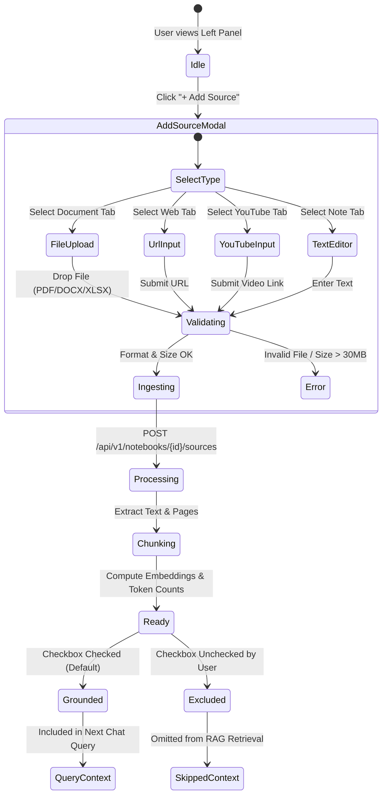
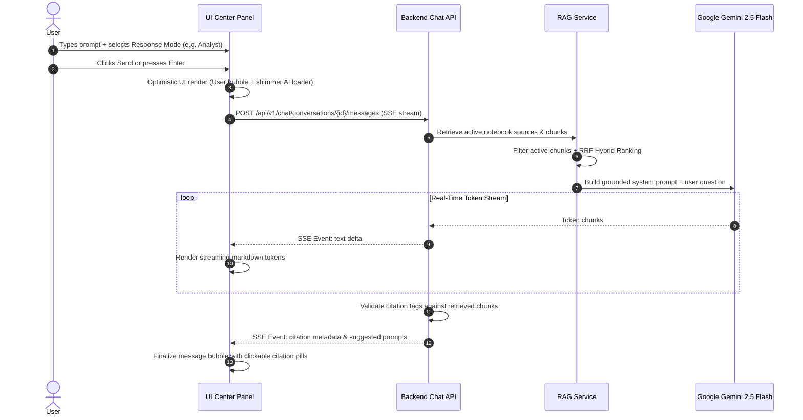

# UDIP — Phase 11 Interaction Map & User Journey Specifications

**Platform:** Universal Document Intelligence Platform (UDIP)  
**Document:** End-to-End User Interaction Flow & State Machines  
**Date:** November 14, 2026  
**Document Version:** 1.0  

---

## 1. High-Level Interaction Overview

UDIP Phase 11 maps all user interactions across four interconnected domains:
1. **Source Management:** Ingestion, validation, selection, and grounding.
2. **Conversational Synthesis:** Streaming grounded Q&A, mode adjustments, and citations.
3. **Studio Deliverables:** Automated transformation of knowledge into 9 professional media artifacts.
4. **Notebook Organization:** Notes authoring, artifact versioning, and workspace sharing.

---

## 2. Source Ingestion & Grounding Selection Journey



### Checkbox Grounding Behavior
- When a user unchecks a source card in the left panel, the frontend immediately updates local state and fires `PATCH /api/v1/notebooks/{id}/sources/{source_id}` with `{"is_active_for_queries": false}`.
- Center-panel chat queries and right-panel Studio generation jobs filter active sources by `is_active_for_queries == true`.

---

## 3. Grounded Conversational Q&A Journey



### Citation Click-Through Flow
1. User sees inline citation tag (e.g. `[1]`, `[esa_cv.pdf p. 1]`).
2. User clicks the citation tag.
3. Center panel triggers event opening the `DocumentDetailModal` slide-over.
4. Modal automatically jumps to the referenced page (e.g., Page 1) and highlights the corresponding text excerpt.

---

## 4. Studio Generation Journeys (9 Engines)

### Journey 1: Audio Overview ("The Deep Dive" Podcast)
```
[User clicks "Audio Overview" tile]
        │
        ▼
[Configuration Dialog: Duration (Short/Standard/Extended), Language (en/es/fr/de/hi)]
        │
        ▼
[POST /api/v1/notebooks/{id}/studio/audio]
        │
        ├── Step 1: Gemini generates 2-host conversational script (Alex & Sam)
        ├── Step 2: edge-tts synthesizes dialogue using Microsoft neural voices
        ├── Step 3: MP3 stream concatenated and written to StorageAdapter
        └── Step 4: Record persisted to studio_artifacts and audio_generations tables
        │
        ▼
[Frontend displays persistent Audio Player: Play, Pause, Seek, Speed (1x-2x), Download MP3]
```

### Journey 2: Slide Deck (Presentation Generator)
```
[User clicks "Slide Deck" tile]
        │
        ▼
[Configuration Dialog: Slide count (4-10), Theme (Business/Modern/Academic)]
        │
        ▼
[POST /api/v1/notebooks/{id}/studio/presentation]
        │
        ├── Step 1: Gemini generates structured slide outline & speaker notes
        ├── Step 2: python-pptx compiles native PowerPoint presentation binary
        ├── Step 3: .pptx file saved to StorageAdapter
        └── Step 4: Record persisted to studio_artifacts and presentations tables
        │
        ▼
[Frontend displays presentation summary, slide preview, and one-click "Download PPTX"]
```

### Journey 3: Interactive Mind Map
```
[User clicks "Mind Map" tile]
        │
        ▼
[POST /api/v1/notebooks/{id}/studio/mindmap]
        │
        ├── Step 1: Gemini extracts core concepts, hierarchical nodes & relationship edges
        └── Step 2: Record persisted to studio_artifacts and mind_maps tables
        │
        ▼
[Frontend launches interactive SVG graph: Pan, Zoom, Drag nodes, View source evidence]
```

### Journey 4: Report Generator
```
[User clicks "Reports" tile]
        │
        ▼
[Configuration Dialog: Select Archetype (Executive Summary, Study Guide, Research, etc.)]
        │
        ▼
[POST /api/v1/notebooks/{id}/studio/report]
        │
        ├── Step 1: Gemini structures comprehensive report with TOC, headings, and citations
        ├── Step 2: python-docx formats and compiles native Microsoft Word document
        ├── Step 3: .docx file saved to StorageAdapter
        └── Step 4: Record persisted to studio_artifacts and reports tables
        │
        ▼
[Frontend renders styled markdown preview and one-click "Download DOCX"]
```

### Journey 5: Interactive Flashcards
```
[User clicks "Flashcards" tile]
        │
        ▼
[POST /api/v1/notebooks/{id}/studio/flashcards]
        │
        ├── Step 1: Gemini extracts core questions, answers, difficulty ratings, citations
        └── Step 2: Record persisted to studio_artifacts and flashcard_decks tables
        │
        ▼
[Frontend renders 3D Flip Card Deck: Click to flip, "Got It" (mastered), "Missed It" (review)]
```

### Journey 6: Quiz Engine
```
[User clicks "Quiz" tile]
        │
        ▼
[Configuration Dialog: Question count (3, 5, 10), Question type (Multiple Choice / Select)]
        │
        ▼
[POST /api/v1/notebooks/{id}/studio/quiz]
        │
        ├── Step 1: Gemini generates questions, choices, correct index, and explanations
        └── Step 2: Record persisted to studio_artifacts and quizzes tables
        │
        ▼
[Frontend launches interactive quiz: Select options, instant scoring, grounded explanations]
```

### Journey 7: Infographics
```
[User clicks "Infographics" tile]
        │
        ▼
[Configuration Dialog: Style (Bento Grid, Process, Timeline)]
        │
        ▼
[POST /api/v1/notebooks/{id}/studio/infographic]
        │
        ├── Step 1: Gemini structures visual sections, metric callouts, and key badges
        └── Step 2: Record persisted to studio_artifacts and infographics tables
        │
        ▼
[Frontend renders visual Bento grid cards with metrics and badges]
```

### Journey 8: Data Table Generator
```
[User clicks "Data Table" tile]
        │
        ▼
[Input Dialog: Natural language extraction prompt (e.g., "Extract all tools and projects")]
        │
        ▼
[POST /api/v1/notebooks/{id}/studio/datatable]
        │
        ├── Step 1: Gemini infers column schemas and extracts matching tabular rows
        ├── Step 2: openpyxl builds styled Excel spreadsheet with auto-width columns
        ├── Step 3: .xlsx file saved to StorageAdapter
        └── Step 4: Record persisted to studio_artifacts and data_tables tables
        │
        ▼
[Frontend displays interactive data table (sortable, filterable) and "Download XLSX"]
```

### Journey 9: Video Storyboard Director
```
[User clicks "Video Storyboard" tile]
        │
        ▼
[Configuration Dialog: Video style (Explainer/Tutorial), Duration (1-3 min)]
        │
        ▼
[POST /api/v1/notebooks/{id}/studio/video]
        │
        ├── Step 1: Gemini builds scene-by-scene script with camera directions & narration
        └── Step 2: Record persisted to studio_artifacts and video_generations tables
        │
        ▼
[Frontend displays scene-by-scene director storyboard with narration cards]
```

---

## 5. Notes Authoring & Chat-to-Note Saving Journey

1. **User Action in Chat:** Below any AI answer bubble, user clicks the **Save Note** icon (bookmark).
2. **Frontend Event:** UI extracts the message text, formats citations, and sends `POST /api/v1/notebooks/{id}/notes` with `{"title": "Note from Chat", "content": message.content, "source_citations": message.citations}`.
3. **Left Panel State:** Switches to the **Notes** tab and shows the newly created note at the top with a green confirmation toast.
4. **Note Editing:** User can click any note in the Left Panel to open the note editor, edit markdown content, pin the note, or delete it.

---

## 6. Error & Edge Case Handling Workflows

| Error Scenario | Detection Point | UI Feedback & Recovery |
| :--- | :--- | :--- |
| **Gemini Rate Limit (429)** | Backend Studio / Chat service catches `ResourceExhausted` | HTTP 429 returned with `{"code": "LLM_RATE_LIMIT_EXCEEDED"}`. Frontend shows a clear countdown badge: *"Google AI rate limit reached. Retrying in 15s..."* |
| **JSON Schema Malformation** | Gemini output contains unescaped characters | `BaseStudioService.generate_json` cleans trailing commas with regex and parses using `strict=False`. Prevents runtime crash. |
| **Unsupported / Corrupted File** | Upload queue detects MIME or header mismatch | Immediate rejection in `UploadQueueWidget` with clear message: *"File format not supported or corrupted."* |
| **Zero Active Sources Selected** | User deselects all sources before asking query | Chat displays helpful prompt: *"Please enable at least one source in the left panel to ask a grounded question."* |
