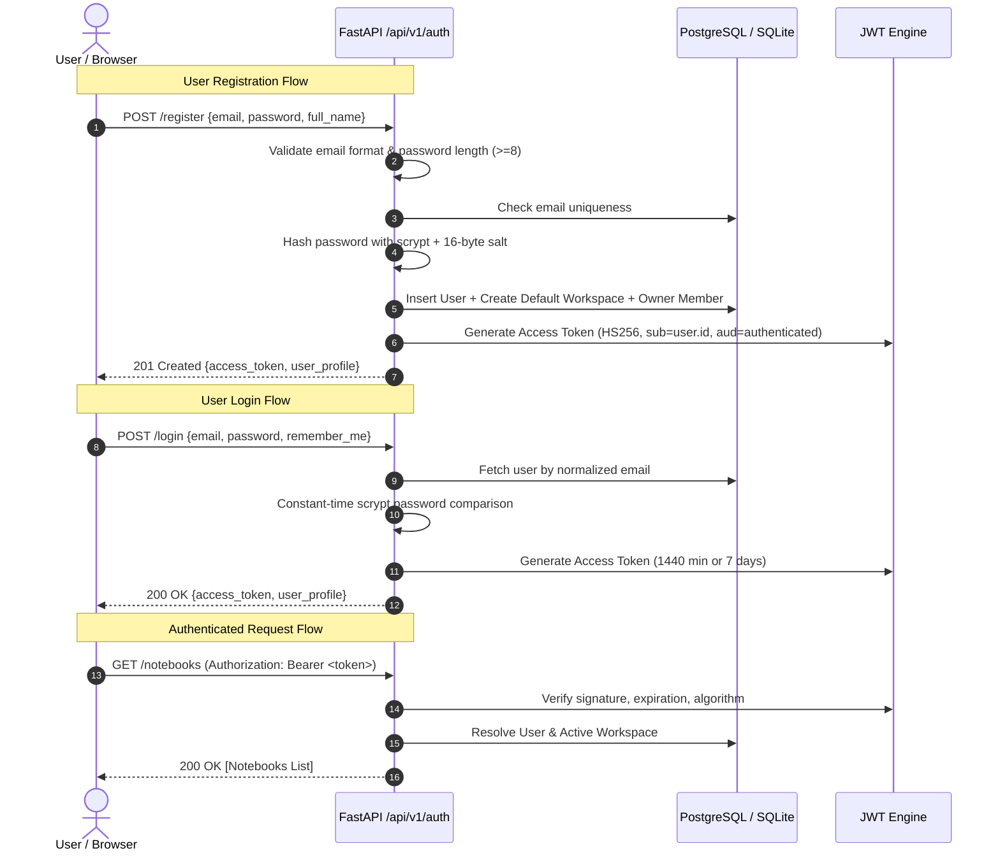

# UDIP Phase 14 — Authentication & Security Implementation Report

**Project:** Universal Document Intelligence Platform (UDIP)  
**Date:** November 15, 2026  
**Auditor:** Principal Security & Auth Architect  
**Cryptographic Primitives:** scrypt (RFC 7914 / OWASP), HMAC-SHA256, PyJWT

---

## 1. Authentication Architecture

Phase 14 delivers a complete, production-grade native authentication system alongside existing Supabase JWT compatibility. Anonymous users are strictly prevented from viewing, creating, or modifying private notebooks and user documents.



---

## 2. Password Hashing Specification

To guard against dictionary attacks, precomputed rainbow tables, and GPU-accelerated cracking without adding fragile C-extension dependencies on Windows, UDIP utilizes Python standard library's memory-hard `hashlib.scrypt`:

```python
# Parameters adhering to OWASP recommendations:
# n = 16384 (CPU/memory cost parameter)
# r = 8 (block size parameter)
# p = 1 (parallelization parameter)
# salt = 16 cryptographically secure random bytes via secrets.token_hex(16)
```

Stored representation:
`scrypt$16384$8$1$<salt_hex>$<derived_hash_hex>`

Verification enforces constant-time comparison via `hmac.compare_digest` to eliminate timing side-channel attacks.

---

## 3. API Endpoints

### 3.1 `POST /api/v1/auth/register`
- **Status:** `201 Created`
- **Request Body:**
  ```json
  {
    "email": "user@example.com",
    "password": "SecurePassword123!",
    "full_name": "Jane Researcher"
  }
  ```
- **Validation:** Normalized lowercase email, password minimum length of 8 characters.
- **Side Effects:** Automatically provisions user row, creates an isolated personal default workspace (`"Personal's Workspace"`), and assigns `owner` membership.

### 3.2 `POST /api/v1/auth/login`
- **Status:** `200 OK`
- **Request Body:**
  ```json
  {
    "email": "user@example.com",
    "password": "SecurePassword123!",
    "remember_me": true
  }
  ```
- **Response:**
  ```json
  {
    "access_token": "eyJhbGciOiJIUzI1NiIsInR5cCI6IkpXVCJ9...",
    "token_type": "bearer",
    "expires_in_minutes": 10080,
    "user": {
      "id": "b5494048-e761-4c8c-bbb1-897aa1eba749",
      "email": "user@example.com",
      "full_name": "Jane Researcher",
      "role": "user",
      "is_active": true,
      "workspaces": [{ "id": "...", "name": "Jane Researcher's Workspace", "is_owner": true }]
    }
  }
  ```

### 3.3 `POST /api/v1/auth/logout`
- **Status:** `200 OK`
- **Action:** Clears client tokens and invalidates the session context.

### 3.4 `POST /api/v1/auth/forgot-password` & `POST /api/v1/auth/reset-password`
- **Forgot Password:** Dispatches password reset token with short TTL (2 hours) and explicit `purpose: "password_reset"`. Generic response prevents email enumeration.
- **Reset Password:** Validates token signature, purpose, and updates `password_hash`.

### 3.5 `GET /api/v1/auth/me`
- **Status:** `200 OK` (Requires `Authorization: Bearer <token>`)
- Returns the caller's verified profile, roles, and accessible workspace list.

---

## 4. Frontend Security & State Management

- **Client Storage:** Access token is saved to `localStorage.getItem("udip_access_token")`.
- **API Interceptor:** `apiClient` in `frontend/src/lib/api-client.ts` automatically injects `Authorization: Bearer <token>` on all outgoing network requests.
- **Session Auto-Restoration:** `AuthProvider` in `frontend/src/context/AuthContext.tsx` verifies the token with `/api/v1/auth/me` on initial mount. If expired, it safely purges storage and triggers re-authentication.
- **Dedicated Auth Pages:** Full-viewport pages (`/login`, `/register`, `/forgot-password`, `/reset-password`) rendered within `#0B0B0B` dark-canvas without generic dashboard sidebars.
- **Interactive Header Account Menu:** Dropdown displays user initials, verified email, active workspace badge, and a secure "Sign Out" button.

---

## 5. Automated Security Test Results

All 13 security and authentication tests passed without errors:

```bash
backend\.venv\Scripts\python.exe -m pytest backend/tests/test_security_auth.py -v
# Result: 13 passed in 10.68s
```
- Missing / malformed headers rejected (401)
- Insecure algorithm `none` rejected (401)
- Forged token signatures rejected (401)
- Expired tokens rejected (401)
- Native registration, scrypt hashing, and login verified
- Deactivated accounts rejected (403)
- Password reset and token verification verified
- Logout verified
