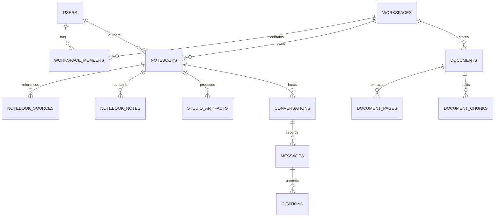

# UDIP Phase 14 — Database Architecture & Permanent Persistence Specification

**Project:** Universal Document Intelligence Platform (UDIP)  
**Date:** November 15, 2026  
**Database Engines:** SQLite (Local Persistence: `storage/udip.db`) / PostgreSQL 16 + pgvector  
**ORM:** SQLAlchemy 2.0 AsyncIO + Alembic Migrations

---

## 1. Architectural Overview

UDIP implements a multi-tenant relational schema with strict foreign key constraints, automatic timestamps, UUID primary keys, and vector embedding columns. In Phase 14, user entity models and migrations have been extended to support native password authentication while preserving seamless compatibility with Supabase Auth.



---

## 2. Core Entity Definitions

### 2.1 Users (`users`)
Stores user profiles and cryptographic authentication credentials.
- `id` (UUID, Primary Key)
- `email` (String 255, Unique, Indexed)
- `password_hash` (String 255, Nullable) — Salted scrypt key derivation string: `scrypt$16384$8$1$<salt>$<hash>`
- `supabase_uid` (String 100, Unique, Indexed, Nullable) — External provider subject identifier
- `full_name` (String 150, Nullable)
- `avatar_url` (Text, Nullable)
- `role` (String 50, Default "user")
- `is_active` (Boolean, Default True)
- `created_at`, `updated_at` (DateTime with TimeZone)

### 2.2 Workspaces & Memberships (`workspaces`, `workspace_members`)
Enforces tenant isolation boundaries. Every document, notebook, and conversation belongs strictly to a workspace.
- `workspaces`: `id`, `name`, `slug` (Unique), `owner_id` (FK -> users.id), `settings` (JSON), timestamps
- `workspace_members`: `id`, `workspace_id` (FK -> workspaces.id), `user_id` (FK -> users.id), `role` (`owner`, `editor`, `viewer`), timestamps

### 2.3 Notebooks (`notebooks`)
Represents an individual research workspace.
- `id` (UUID, Primary Key)
- `workspace_id` (UUID, FK -> workspaces.id, Indexed)
- `user_id` (UUID, FK -> users.id, Indexed)
- `title` (String 255)
- `description` (Text, Nullable)
- `color` (String 32, Default "blue")
- `cover_image_url` (String 512, Nullable)
- `settings_json` (JSON / JSONB)
- `is_archived` (Boolean, Default False)
- `is_shared` (Boolean, Default False)
- `created_at`, `updated_at` (DateTime with TimeZone)

### 2.4 Notebook Sources (`notebook_sources`)
Maps documents, raw text, or external URLs (YouTube, web pages) into a notebook.
- `id` (UUID, Primary Key)
- `notebook_id` (UUID, FK -> notebooks.id, Cascade Delete)
- `source_type` (String 32: `document`, `url`, `youtube`, `text_note`)
- `title` (String 255)
- `document_id` (UUID, FK -> documents.id, Nullable)
- `url` (String 1024, Nullable)
- `raw_content` (Text, Nullable)
- `token_count` (Integer, Default 0)
- `extraction_status` (String 32: `pending`, `ready`, `failed`)
- `is_active_for_queries` (Boolean, Default True)

### 2.5 Notebook Notes (`notebook_notes`)
User-authored notes and synthesized excerpts.
- `id` (UUID, Primary Key)
- `notebook_id` (UUID, FK -> notebooks.id, Cascade Delete)
- `user_id` (UUID, FK -> users.id)
- `title` (String 255)
- `content` (Text)
- `color` (String 32)
- `is_pinned` (Boolean, Default False)
- `source_citations_json` (JSON)
- `created_at`, `updated_at` (DateTime with TimeZone)

### 2.6 Studio Artifacts (`studio_artifacts`)
Persistent storage for all 9 Studio generation outputs.
- `id` (UUID, Primary Key)
- `notebook_id` (UUID, FK -> notebooks.id, Cascade Delete)
- `user_id` (UUID, FK -> users.id)
- `artifact_type` (String 32: `audio_overview`, `slides`, `video_overview`, `mind_map`, `reports`, `flashcards`, `quiz`, `infographic`, `data_table`)
- `title` (String 255)
- `status` (String 32: `completed`, `processing`, `failed`)
- `data_json` (JSON / JSONB) — Complete structured payload (e.g., questions, slides, nodes)
- `export_file_path` (String 512, Nullable) — Path to downloadable binary (.pptx, .xlsx, .mp3)
- `generation_time_ms` (Float)
- `created_at`, `updated_at` (DateTime with TimeZone)

---

## 3. Migration Lineage

The Alembic migration chain has been cleanly extended to version `20261115_0005`:

1. `20261113_0001_initial_schema.py` — Base schemas (`users`, `workspaces`, `documents`, `conversations`)
2. `20261113_0002_intelligence_models.py` — Summaries, insights, comparisons, extraction tables
3. `20261113_0003_actions_and_notifications.py` — Action items, reminders, notifications
4. `20261114_0004_notebooks_and_studio.py` — Notebooks, sources, notes, studio artifact tables
5. `20261115_0005_user_password_hash.py` — Native authentication password hash column

```bash
# Migration verification command
backend\.venv\Scripts\python.exe -m pytest backend/tests/test_alembic_migrations.py -v
# Result: 1 passed in 3.04s (verified upgrade and downgrade lifecycle)
```

---

## 4. Multi-Tenant Query Isolation

All queries enforce tenant isolation at the database level:

```python
# Guaranteed workspace boundary on all notebook queries
stmt = (
    select(Notebook)
    .where(
        Notebook.id == notebook_id,
        Notebook.workspace_id == workspace.id,
    )
)
```

Cross-tenant access attempts are rejected with HTTP 403 Forbidden before any document, chunk, or artifact can be accessed.
