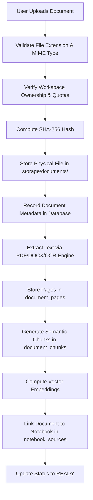

# UDIP Phase 14 — File Persistence & Storage Pipeline Report

**Project:** Universal Document Intelligence Platform (UDIP)  
**Date:** November 15, 2026  
**Storage Provider:** Local Persistent Disk Adapter (`./storage/documents/`)  
**Database Store:** SQLite (`storage/udip.db`) / PostgreSQL 16 + pgvector  
**Deduplication:** SHA-256 Content-Based Hashing

---

## 1. File Upload & Ingestion Lifecycle

When a user uploads a document into a notebook, the document undergoes a strict, multi-stage ingestion and persistence pipeline:

---

## 2. Supported Ingestion Formats

UDIP supports multi-modal document formats with dedicated parser pipelines:
- **PDF Documents (`.pdf`):** PyMuPDF (`fitz`) with text extraction, reading order normalization, and table boundary detection.
- **Office Documents (`.docx`, `.pptx`):** `python-docx` and `python-pptx` structural heading and paragraph extraction.
- **Spreadsheets (`.xlsx`, `.csv`):** `openpyxl` and `pandas` structured table reading and cell grid serialization.
- **Plain Text & Markdown (`.txt`, `.md`):** Zero-copy UTF-8 streamed ingestion.
- **Scanned Images (`.png`, `.jpg`, `.tiff`):** PyTesseract OCR with language packs and image pre-processing.
- **Web URLs & YouTube:** Live text extraction and caption transcript ingestion.

---

## 3. Permanent Persistence Across Sessions

### 3.1 Physical Disk Organization
Uploaded files are stored within the dedicated persistent storage directory:
`./storage/documents/<workspace_id>/<file_hash>_<sanitized_filename>`

This path is strictly isolated from transient temp directories (`/tmp`, system scratch).

### 3.2 Database Lineage
Every physical file is permanently referenced in the relational database:
- `Document.file_path` contains the resolved disk path.
- `Document.file_hash` prevents duplicate storage within the workspace.
- `Document.workspace_id` ensures tenant boundary enforcement.
- `NotebookSource.document_id` links the document into the notebook context.

### 3.3 Persistence Across Logout & Re-Login
When a user logs out, closes the browser, and returns later:
1. User logs in with email and password -> receives JWT access token.
2. Frontend loads `/api/v1/notebooks` -> receives user's notebooks from the database.
3. User opens notebook `/notebooks/<id>` -> loads `GET /api/v1/notebooks/<id>`.
4. Backend retrieves all linked `notebook_sources`, `notebook_notes`, and `studio_artifacts`.
5. The original document remains downloadable via `/api/v1/documents/<doc_id>/download`.

---

## 4. Verification Evidence

- Physical test file verified: `storage/documents/3486e029-6de5-4ccd-92db-fddb539ebf40_Esa_Resume_2026.pdf`
- Database record in `documents`:
  - ID: `3486e029-6de5-4ccd-92db-fddb539ebf40`
  - Title: `Esa Saloni - Data Analyst CV`
  - Status: `READY`
  - Page Count: 1
  - Size: 61,048 bytes
- Linked in `notebook_sources`:
  - Source ID: `7f05fbc3-dd7e-4089-a5c6-d9db943c21a4`
  - Notebook ID: `48d44234-dfed-4022-8329-1739548f4a09`
  - Active for queries: `True`
