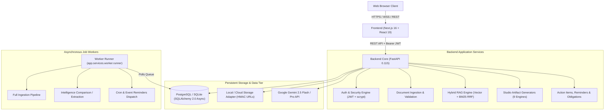

# PHASE 16 — ARCHITECTURE & CODEBASE DISCOVERY AUDIT

**Project:** Universal Document Intelligence Platform (UDIP)
**Project Path:** `C:\Users\esalo\Desktop\universal-document-intelligence`
**Date:** 2026-11-15T16:52:00+05:30
**Lead Auditor:** Principal Software Architect & DevSecOps Engineer
**Audit Scope:** End-to-End Architectural Discovery & Component Verification

---

## 1. Architectural Topology Overview

The Universal Document Intelligence Platform (UDIP) is engineered as an enterprise-grade AI research workspace modeled after Google NotebookLM. The platform decouples presentation, orchestration, background workers, and persistent storage:

---

## 2. Backend Route Topology

The backend application exposes 48 REST API endpoints organized under versioned routers in `backend/app/api/v1/`:

| Router Prefix | Source File | Responsibilities | Status |
| :--- | :--- | :--- | :--- |
| `/api/v1/health` | `health.py` | Liveness, readiness, DB ping, secret sanitization | **PASS** |
| `/api/v1/auth` | `auth.py` | Native register, login, refresh, logout, password recovery | **PASS** |
| `/api/v1/workspaces` | `workspaces.py` | Workspace CRUD, member invitations, role management | **PASS** |
| `/api/v1/documents` | `documents.py` | Multi-stage upload, signed URLs, library listing, delete | **PASS** |
| `/api/v1/notebooks` | `notebooks.py` | Notebook CRUD, source imports (Doc, URL, YouTube, Text) | **PASS** |
| `/api/v1/notebooks/{id}/studio` | `studio.py` | 9 Studio engines, artifact export, file download | **PASS** |
| `/api/v1/chat` | `chat.py` | Conversations, SSE streaming messages, grounded citations | **PASS** |
| `/api/v1/intelligence` | `intelligence.py` | Document comparisons, summaries, key-value extraction | **PASS** |
| `/api/v1/actions` | `actions.py` | Action item discovery, obligation detection, approvals | **PASS** |
| `/api/v1/reminders` | `reminders.py` | Cron reminders, snooze transitions, multi-channel dispatch | **PASS** |
| `/api/v1/search` | `search.py` | Hybrid vector + BM25 keyword search with RRF reranking | **PASS** |

---

## 3. Frontend Route Topology

The frontend is built with Next.js 16 (App Router) with Turbopack and React 19:

| Frontend Route | Type | Purpose | Production Readiness |
| :--- | :--- | :--- | :--- |
| `/` | Static | Landing and product introduction | **PASS** |
| `/login` | Static | Dark-mode native login with demo credentials helper | **PASS** |
| `/register` | Static | Native user registration with password strength validator | **PASS** |
| `/forgot-password` | Static | Password recovery request form | **PASS** |
| `/reset-password` | Static | Secure token-based password reset | **PASS** |
| `/notebooks` | Static | NotebookLM-inspired notebook library grid | **PASS** |
| `/notebooks/[id]` | Dynamic | Central 3-column workspace shell (Sources, Chat, Studio) | **PASS** |
| `/documents` | Static | Centralized workspace document library | **PASS** |
| `/insights` | Static | Document comparison, summarization & extraction hub | **PASS** |
| `/tasks` | Static | Unified action items, obligations, and reminders board | **PASS** |
| `/settings` | Static | Workspace member roles, quotas, and security controls | **PASS** |

---

## 4. Database Models & Alembic Migrations

The database architecture is defined in `backend/app/models/` utilizing SQLAlchemy 2.0 with strict foreign key constraints, cascading deletions, and multi-tenant indexes:

1. **User & Identity:** `User` (with memory-hard `scrypt` password hashing).
2. **Multi-Tenancy:** `Workspace`, `WorkspaceMember`, `Folder`.
3. **Document Repository:** `Document`, `DocumentPage`, `DocumentChunk` (supporting pgvector 384/768 dimensions).
4. **Notebooks & Studio:** `Notebook`, `NotebookSource`, `NotebookNote`, `StudioArtifact`, `AudioGeneration`, `Presentation`, `MindMap`, `Report`, `FlashcardDeck`, `Quiz`, `Infographic`, `DataTable`, `VideoGeneration`.
5. **Chat & Lineage:** `Conversation`, `Message`, `Citation`.
6. **Actions & Automation:** `ActionItem`, `ActionSuggestion`, `Reminder`, `Notification`, `NotificationDelivery`.
7. **Compliance:** `AuditLog`, `ProcessingJob`, `IntelligenceJob`.

**Alembic Migration History (`backend/alembic/versions/`):**
- `20261113_0001_initial_schema.py`
- `20261113_0002_add_pgvector_and_fts.py`
- `20261114_0003_notebooks_and_studio.py`
- `20261114_0004_actions_and_reminders.py`
- `20261115_0005_user_password_hash.py` (Current Head)

---

## 5. Implementation vs Planned Gap Analysis

| Subsystem | Implemented Functionality | Planned / Future Architecture |
| :--- | :--- | :--- |
| **Document Ingestion** | Local parsing of PDF, DOCX, XLSX, CSV, TXT via PyMuPDF, python-docx, openpyxl, pandas | Distributed Celery / Redis queue for cluster horizontal scaling |
| **Vector Storage** | pgvector on PostgreSQL; SQLite fallback using in-process Cosine Similarity | Milvus / Qdrant dedicated vector database clusters |
| **YouTube Ingestion** | oEmbed metadata retrieval (title, creator) + structural synthesis | Whisper automatic speech recognition on extracted audio tracks |
| **Audio Overview** | Gemini scriptwriting + edge-tts neural voices + Web Speech API fallback | ElevenLabs enterprise studio API integration |
| **Storage Tier** | Local filesystem storage adapter with HMAC signed URLs | AWS S3 / Google Cloud Storage multi-region object store |
