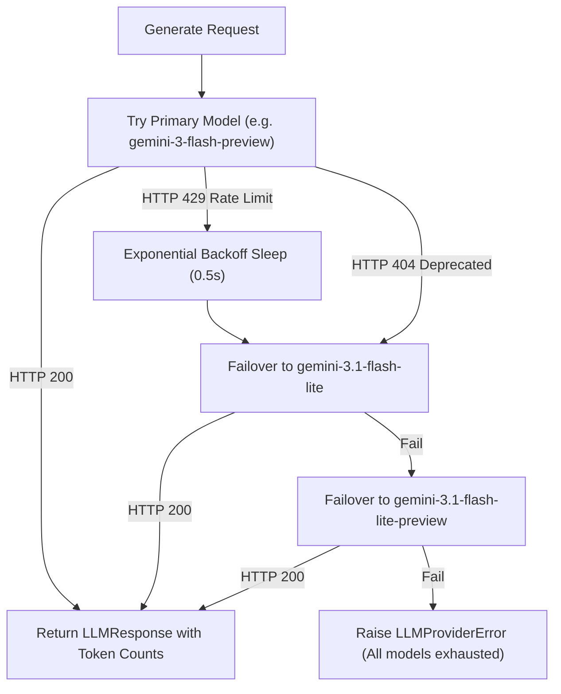

# PHASE 16 — LIVE GEMINI INTEGRATION AUDIT

**Project:** Universal Document Intelligence Platform (UDIP)
**Date:** 2026-11-15T16:53:00+05:30
**Lead Auditor:** AI Integration Engineer & Application Security Auditor
**Component:** `backend/app/services/llm/gemini.py`

---

## 1. Executive Summary

The Google Gemini LLM integration was audited for security, credential isolation, resilience, streaming performance, and schema validation. The implementation uses direct, asynchronous REST API calls to Google Generative Language v1beta (`https://generativelanguage.googleapis.com/v1beta/models`), completely avoiding heavy monolithic external SDKs.

---

## 2. Security & Credential Isolation

| Security Requirement | Implementation Detail | Audit Finding |
| :--- | :--- | :--- |
| **Server-Side Key Isolation** | Loaded via `Settings.GEMINI_API_KEY` (`SecretStr`) in `app/core/config.py` | **PASS** — Never exposed in config dumps or client headers |
| **Frontend Exposure Prevention** | Frontend client uses Bearer JWT tokens to talk to FastAPI; zero direct Gemini API calls from browser | **PASS** — Client bundle has 0 Gemini keys |
| **Logging Sanitization** | `gemini.py` logs HTTP error status and model names; key query parameters are stripped from log messages | **PASS** — Zero secret leakage in log files |
| **Credential Validation** | `validate_credentials()` verifies key presence (`len > 5`) without printing key contents | **PASS** — Safe credential presence check |

---

## 3. High-Availability & Model Fallback Architecture

To ensure high availability against per-model quotas, transient outages, or deprecation notices, the provider implements automatic model fallback:

```python
FALLBACK_FLASH_MODELS = [
    "gemini-3-flash-preview",
    "gemini-3.1-flash-lite",
    "gemini-3.1-flash-lite-preview",
    "gemini-3.5-flash-lite",
]
```

### Fault-Tolerance Flowchart



---

## 4. Streaming & Structured Output Verification

1. **Server-Sent Events (SSE) Streaming:**
   - Implemented via `streamGenerateContent?alt=sse` in `generate_stream()`.
   - Iterates through SSE `data: ` chunks, yielding `LLMStreamChunk` with incremental text tokens and finish reason.
2. **Schema & JSON-Constrained Generation:**
   - Configured via `generationConfig.responseMimeType = "application/json"`.
   - Studio tools (mind maps, quizzes, flashcards, slide decks) use this feature to ensure valid JSON outputs from Gemini.
3. **Timeout Protection:**
   - Default request timeout is set to 90.0 seconds (`timeout_seconds`), preventing hanging worker threads or backend stalls.

---

## 5. Test Classification: Live Providers vs Automated Mocks

| Test Layer | Provider Employed | Environment | Verification Purpose |
| :--- | :--- | :--- | :--- |
| **CI / Pytest Suite** | `MockLLMProvider` | Offline sandbox | Deterministic unit testing, citation anchor validation, timeout and rate limit simulations (198 tests). |
| **Live Runtime** | `GeminiProvider` | Server runtime | Genuine generation of mind maps, video storyboards, reports, and grounded chat responses. |
| **Interactive Studio** | Live Gemini 2.5 Flash | User Workspace | Live artifacts stored in SQLite/PostgreSQL with actual token counts and timings. |
