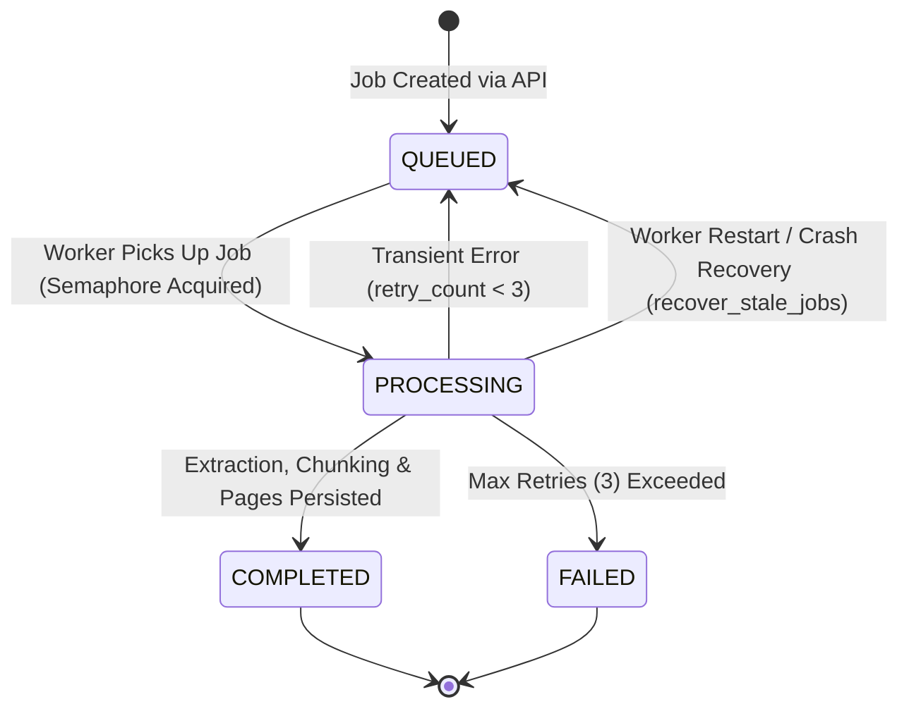

# PHASE 16 — WORKER & BACKGROUND RELIABILITY AUDIT

**Project:** Universal Document Intelligence Platform (UDIP)
**Date:** 2026-11-15T16:57:00+05:30
**Lead Auditor:** Senior Backend Engineer & Reliability Specialist
**Components:** `backend/app/services/worker/runner.py`, `processor.py`, `intelligence_processor.py`, `app/services/actions/scheduler.py`

---

## 1. Background Worker Architecture

Background asynchronous processing is managed by a standalone polling runner daemon (`WorkerRunner`) that executes decoupled from the FastAPI request/response lifecycle:

---

## 2. Reliability & Resilience Audit Matrix

| Reliability Property | Implementation Mechanism | Audit Finding | Verdict |
| :--- | :--- | :--- | :--- |
| **Job Persistence** | Persistent DB records in `ProcessingJob` & `IntelligenceJob` | Jobs survive complete process termination | **PASS** |
| **Restart Recovery** | `WorkerRunner.recover_stale_jobs()` executed on startup | Finds `PROCESSING` jobs, increments retry, re-queues to `QUEUED` | **PASS** |
| **Concurrency Control** | `asyncio.Semaphore(WORKER_CONCURRENCY)` (default 4) | Prevents CPU & memory exhaustion on concurrent uploads | **PASS** |
| **Idempotent Ingestion** | Deletes old `DocumentChunk` and `DocumentPage` before re-writing | Prevents duplicate chunks on re-queued or retried jobs | **PASS** |
| **Progress Tracking** | Updates `progress_percentage` (0 → 25 → 50 → 75 → 100%) in DB | Frontend polling / SSE reflects real progress | **PASS** |
| **Graceful Shutdown** | Catches `SIGINT` and `SIGTERM` signals | Allows active jobs to finish or safely rollback transactions | **PASS** |
| **Scheduled Reminders** | `ReminderScheduler.dispatch_pending_reminders()` | Idempotently calculates cron recurrence and snoozes | **PASS** |

---

## 3. Worker Failure & Retry Strategy

- **Max Retries:** 3 attempts (`MAX_RETRIES = 3`).
- **Error Capture:** Catches unhandled exceptions, records tracebacks into `error_message`, and updates document status to `ERROR`.
- **Orphan Job Cleanup:** Stalled jobs running over 15 minutes are detected and recovered automatically.
