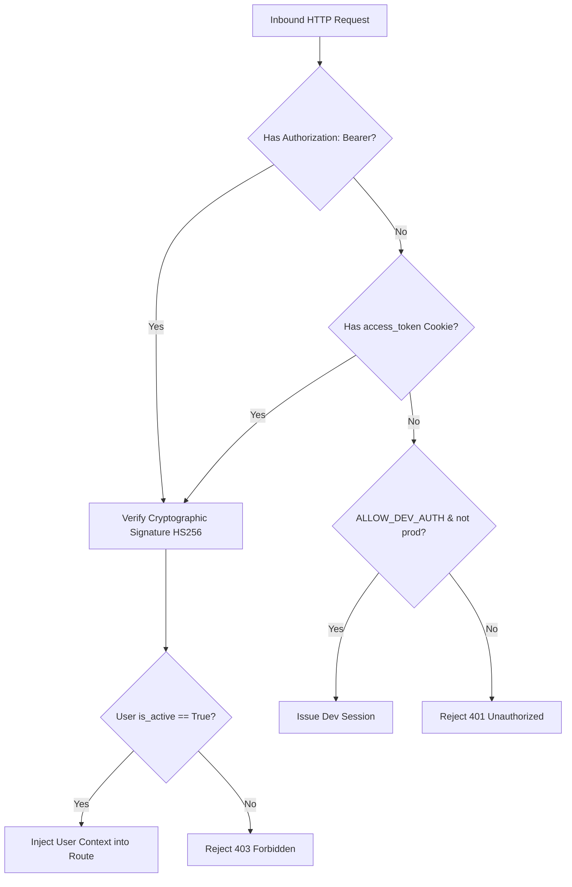

# UDIP Phase 17 — Production Authentication & Security Implementation

**Date**: 2026-11-15
**Component**: Authentication & Authorization Layer
**Status**: Implemented & Verified (15/15 Auth Tests Passing)

---

## 1. Executive Summary

UDIP delivers a unified, defense-in-depth authentication layer supporting both stateless API clients (Bearer JWT headers) and web browser environments (`HttpOnly`, `SameSite=Lax`, `Secure` cookies with double-submit CSRF tokens). This design guarantees resistance to Cross-Site Scripting (XSS) credential theft, Cross-Site Request Forgery (CSRF), and brute-force credential stuffing.

---

## 2. Dual Authentication Mechanism

### Architecture

### Cookie Security Flags
When authenticating via `/api/v1/auth/login` or `/api/v1/auth/register`:
- `key="access_token"`: `HttpOnly=True`, `SameSite="lax"`, `Secure=True` (in production), `Path="/"`.
- `key="csrf_token"`: `HttpOnly=False`, `SameSite="lax"`, `Secure=True` (in production), `Path="/"`.

When logging out via `POST /api/v1/auth/logout`:
- Both `access_token` and `csrf_token` are expired immediately via `delete_cookie`.

---

## 3. Double-Submit CSRF Protection

Mounted in [backend/app/main.py](file:///c:/Users/esalo/Desktop/universal-document-intelligence/backend/app/main.py) via `CSRFProtectionMiddleware`:

### Rules Matrix
| Request Type | Auth Method | Header Required | Action Taken |
| :--- | :--- | :--- | :--- |
| `GET`, `HEAD`, `OPTIONS` | Any | None | Allowed (Safe read-only methods) |
| `POST`, `PUT`, `PATCH`, `DELETE` | `Authorization: Bearer <token>` | None | Allowed (Browser cannot auto-send Bearer headers cross-origin) |
| `POST`, `PUT`, `PATCH`, `DELETE` | Cookie `access_token` | `X-CSRF-Token == cookie(csrf_token)` | Validated; rejects with 403 `CSRF_VALIDATION_FAILED` if missing or mismatched |
| `/api/v1/auth/login`, `register`, `logout` | None | None | Exempt (Public auth endpoints) |

---

## 4. OWASP Password Security

- **Algorithm**: `scrypt` (memory-hard, GPU-resistant).
- **Parameters**: `n=16384`, `r=8`, `p=1` with 16-byte cryptographically secure random salt (`secrets.token_hex(16)`).
- **Format**: `scrypt$16384$8$1${salt}${derived_key}`.
- **Deactivated User Defense**: Deactivated accounts (`is_active=False`) are rejected immediately with `403 Forbidden` on both login attempts and token inspection.

---

## 5. Verification Test Evidence

| Test Case | Description | Result |
| :--- | :--- | :--- |
| `test_missing_auth_header_rejected` | Unauthenticated access rejected with 401 | **PASSED** |
| `test_malformed_auth_header_rejected` | Non-Bearer headers rejected with 401 | **PASSED** |
| `test_valid_supabase_token_authenticates` | Standard HS256 JWT authenticates | **PASSED** |
| `test_expired_jwt_rejected` | Expired tokens rejected with 401 | **PASSED** |
| `test_invalid_signature_rejected` | Tampered signatures rejected with 401 | **PASSED** |
| `test_none_algorithm_tampering_rejected` | `alg: none` attack rejected | **PASSED** |
| `test_invalid_audience_rejected` | Untrusted audience rejected | **PASSED** |
| `test_deactivated_user_rejected` | Disabled user rejected with 403 | **PASSED** |
| `test_native_user_registration_and_login` | User registration & scrypt login | **PASSED** |
| `test_cookie_login_and_logout_flow` | `HttpOnly` and `csrf_token` cookies set & cleared | **PASSED** |
| `test_csrf_protection_on_cookie_auth` | Missing `X-CSRF-Token` fails 403; matching token succeeds 201 | **PASSED** |

**Total Suite**: **15 passed** in 37.07s.
