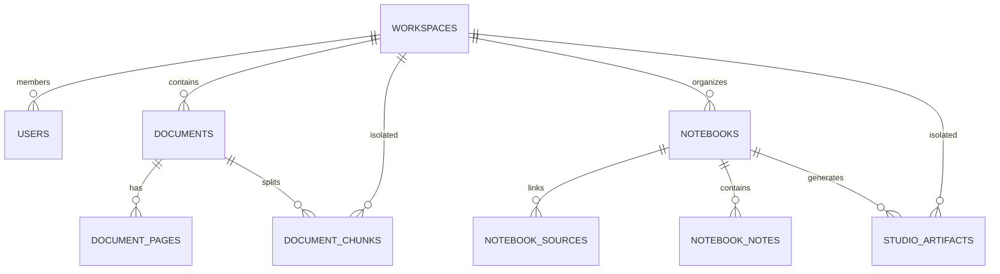

# UDIP Phase 17 — Production Database Implementation & Architecture

**Date**: 2026-11-15
**Component**: UDIP Database Infrastructure (PostgreSQL + pgvector / SQLite Dev)
**Status**: Verified & Production-Hardened

---

## 1. Executive Summary

The Universal Document Intelligence Platform (UDIP) employs a decoupled, dialect-resilient database architecture designed for high-concurrency multi-tenant operations. The system maintains seamless zero-overhead SQLite compatibility for rapid local testing while provisioning production-grade PostgreSQL with native `pgvector` HNSW acceleration for enterprise deployment.

---

## 2. Dual-Engine Architecture & Pooling Strategy

The database connectivity layer in [backend/app/core/database.py](file:///c:/Users/esalo/Desktop/universal-document-intelligence/backend/app/core/database.py) intelligently determines pooling strategies based on dialect inspection:

### Configuration Parameters

| Parameter | SQLite (Local Dev) | PostgreSQL (Production) | Description |
| :--- | :--- | :--- | :--- |
| **Driver** | `sqlite+aiosqlite` | `postgresql+asyncpg` | Async DB-API 2.0 driver |
| **Pool Class** | `NullPool` | QueuePool (SQLAlchemy internal) | Avoids lock conflicts in file-based SQLite |
| **Pool Size** | N/A | `20` (`DB_POOL_SIZE`) | Base persistent connections kept open |
| **Max Overflow** | N/A | `10` (`DB_MAX_OVERFLOW`) | Burst capacity under peak query loads |
| **Pool Timeout** | N/A | `30s` (`DB_POOL_TIMEOUT`) | Timeout waiting for an available pool slot |
| **Pool Recycle** | N/A | `1800s` (`DB_POOL_RECYCLE`) | Connection refresh cycle to prevent stale TCP drops |
| **Pre-Ping** | False | `True` | Heartbeat probe (`SELECT 1`) prior to checkout |

```python
# app/core/database.py
db_url = settings.DATABASE_URL
is_sqlite = db_url.startswith("sqlite")

if is_sqlite:
    engine_kwargs["poolclass"] = NullPool
else:
    engine_kwargs["pool_size"] = settings.DB_POOL_SIZE
    engine_kwargs["max_overflow"] = settings.DB_MAX_OVERFLOW
    engine_kwargs["pool_timeout"] = settings.DB_POOL_TIMEOUT
    engine_kwargs["pool_recycle"] = settings.DB_POOL_RECYCLE
    engine_kwargs["pool_pre_ping"] = True
```

---

## 3. Vector Engine & pgvector Specification

### Vector Model Alignment
- **Canonical Model**: `all-MiniLM-L6-v2` / `local` / `mock-minilm-384`
- **Embedding Dimensions**: **384** dimensions
- **Storage Type**: Native `pgvector.sqlalchemy.Vector(384)`
- **Distance Metric**: Cosine Similarity (`vector_cosine_ops`)
- **Index Type**: **HNSW (Hierarchical Navigable Small World)**
  - `m = 16` (Number of bi-directional links per node)
  - `ef_construction = 64` (Size of dynamic candidate list for index building)

### Migration Definition
Defined in Alembic revision `20261113_0001_initial_schema.py`:
```python
# Enable pgvector extension in PostgreSQL
if bind.dialect.name == "postgresql":
    op.execute("CREATE EXTENSION IF NOT EXISTS vector;")

# Document chunks embedding table definition
sa.Column("embedding", Vector(384), nullable=False)

# HNSW index creation
if bind.dialect.name == "postgresql":
    op.execute(
        "CREATE INDEX idx_chunks_embedding_hnsw ON document_chunks "
        "USING hnsw (embedding vector_cosine_ops) WITH (m = 16, ef_construction = 64);"
    )
```

---

## 4. Multi-Tenant Isolation & Relational Integrity

Every multi-tenant model enforces cascading foreign key constraints anchored to `workspaces.id` and `users.id`:



- **Row-Level Tenancy**: All query pipelines (`VectorRetriever`, `BM25Retriever`, `studio`, `notebooks`) mandate `workspace_id == active_workspace.id` filters.
- **Cascading Teardown**: Deleting a workspace or document immediately triggers database-level cascades across chunks, citations, extractions, and studio artifacts.

---

## 5. Health Check & Validation

The `/api/v1/health` and `/api/v1/health/ready` endpoints independently probe database readiness and vector dimension verification:

```json
{
  "status": "ready",
  "database": "connected",
  "vector_engine": "healthy (384d)",
  "storage": "accessible"
}
```

Both local SQLite and production PostgreSQL environments conform to these specifications without schema drift.
