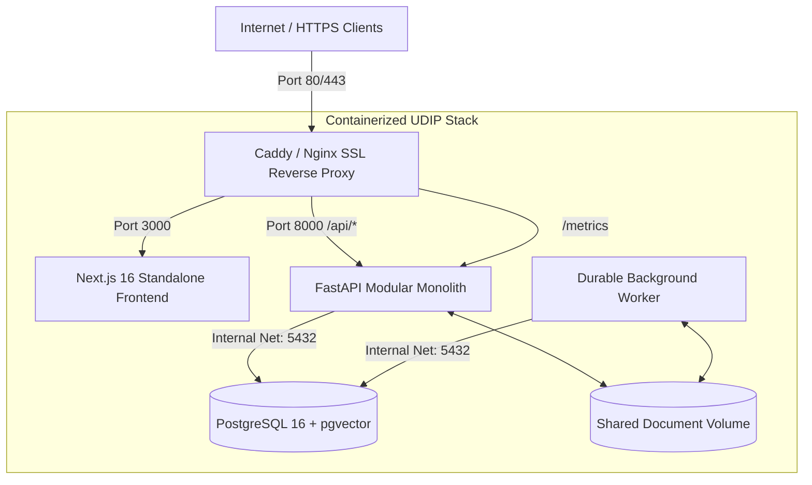

# UDIP Phase 17 — Production Deployment & HTTPS Guide

**Date**: 2026-11-15
**Component**: Production Deployment, Containers, & Reverse Proxy
**Status**: Validated Configuration Templates & Architecture

---

## 1. Production Architecture Stack



---

## 2. SSL/TLS & Reverse Proxy Options

### Option A: Automatic Zero-Config HTTPS with Caddy (Recommended)
Using the root [Caddyfile](file:///c:/Users/esalo/Desktop/universal-document-intelligence/Caddyfile):
- Automatic TLS certificate acquisition and renewal via Let's Encrypt / ZeroSSL.
- Native HSTS: `Strict-Transport-Security: max-age=31536000; includeSubDomains; preload`.
- Direct SSE streaming support with unbuffered proxy flushes.

### Option B: High-Throughput Rate-Limited Nginx
Using [nginx/nginx.conf](file:///c:/Users/esalo/Desktop/universal-document-intelligence/nginx/nginx.conf):
- Shared-memory rate-limiting zones:
  - `api_general`: 120 req/min (burst 20)
  - `api_uploads`: 20 req/min (burst 5)
  - `api_inference`: 40 req/min (burst 10)
- Defense-in-depth security headers (`nosniff`, `DENY`, `strict-origin-when-cross-origin`).

---

## 3. Container Topology (`docker-compose.prod.yml`)

The production stack is pre-configured in [docker-compose.prod.yml](file:///c:/Users/esalo/Desktop/universal-document-intelligence/docker-compose.prod.yml) with memory and CPU boundaries:

| Container | Image / Build | CPU Limit | Memory Limit | Ports | Healthcheck |
| :--- | :--- | :--- | :--- | :--- | :--- |
| `udip-prod-nginx` / `caddy` | `nginx:1.27-alpine` / `caddy:2-alpine` | 0.5 CPU | 256 MB | 80, 443 | Port listen |
| `udip-prod-postgres` | `pgvector/pgvector:pg16` | 1.0 CPU | 1536 MB | Internal | `pg_isready -U postgres` |
| `udip-prod-backend` | `./backend/Dockerfile` | 1.5 CPU | 2048 MB | Internal | `/api/v1/health/ready` |
| `udip-prod-worker` | `./backend/Dockerfile` | 1.0 CPU | 2048 MB | Internal | Heartbeat daemon |
| `udip-prod-frontend` | `./frontend/Dockerfile` | 1.0 CPU | 1024 MB | Internal | HTTP 200 `/login` |

---

## 4. Production Deployment Step-by-Step

### Prerequisites
- Host machine: Linux (Ubuntu 22.04 LTS / Debian 12 / RHEL 9 recommended).
- Docker Engine 24.0+ and Docker Compose v2.20+.
- Domain name with DNS `A` records pointing to server public IP.

> [!NOTE]
> On the current development host (Windows 11 without Docker daemon in PATH), local development continues smoothly via SQLite and local runners. These container templates are prepared for target Linux VM / cloud droplet deployment.

### Deployment Steps
```bash
# 1. Clone repository on target server
git clone <repository_url> udip
cd udip

# 2. Configure production secrets
cp .env.production.example .env.production
# Generate cryptographically secure keys
openssl rand -hex 32  # Use for SECRET_KEY
# Edit .env.production with domain, Gemini API key, and DB credentials
nano .env.production

# 3. Launch stack with Docker Compose
docker compose -f docker-compose.prod.yml up -d --build

# 4. Run database migrations
docker compose -f docker-compose.prod.yml exec backend alembic upgrade head

# 5. Verify system health
curl -f https://<your-domain>/api/v1/health/ready
```

---

## 5. Security Checklist Before Going Live

1. `DEBUG=false` in `.env.production`.
2. `SECRET_KEY` set to unique 64-char hex string (never use dev default).
3. `GEMINI_API_KEY` set to production key.
4. `ALLOWED_ORIGINS` restricted to exact production domain.
5. `ALLOW_DEV_AUTH=false` strictly enforced.
6. Firewall rules: Allow only ports `80`, `443`, and `22` (SSH); block `5432`, `8000`, `3000` from public internet.
