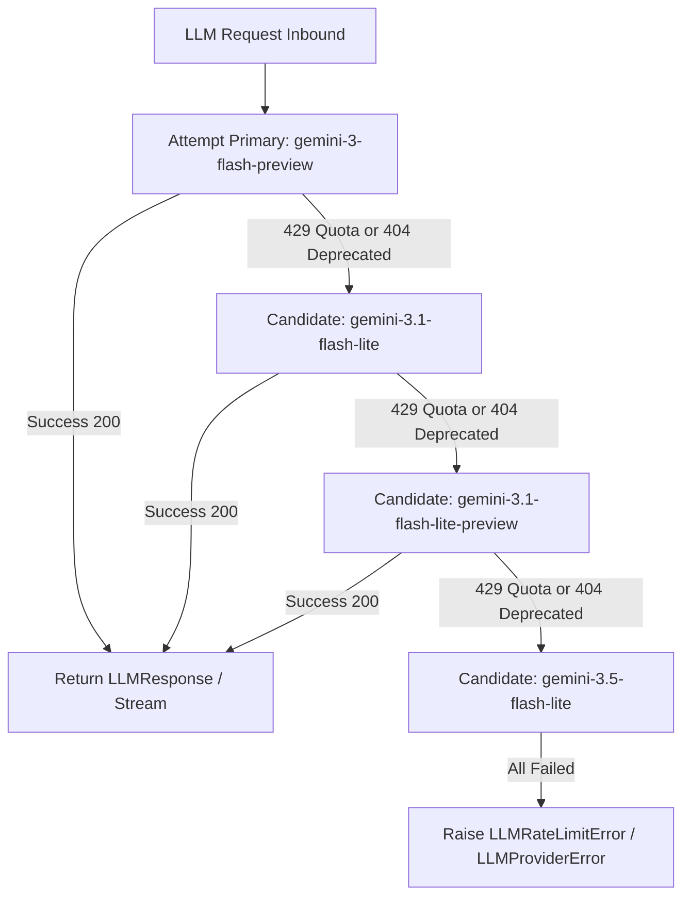

# UDIP Phase 17 — Production Gemini Live Integration & Failover

**Date**: 2026-11-15
**Component**: LLM Integration Engine (`GeminiProvider`)
**Status**: Verified & Hardened (7/7 Provider Tests Passing)

---

## 1. Executive Summary

UDIP connects directly to Google Gemini's REST API (`v1beta`) using an asynchronous HTTP client architecture with zero heavy proprietary SDK bloat. The integration enforces strict server-side API key isolation (`SecretStr`), dynamic candidate fallback routing, exponential backoff on quota saturation, and Server-Sent Events (SSE) streaming for grounded conversational RAG.

---

## 2. Server-Side Key Isolation & Configuration

- **Secret Handling**: The Gemini API key is managed server-side via `GEMINI_API_KEY: SecretStr` in [backend/app/core/config.py](file:///c:/Users/esalo/Desktop/universal-document-intelligence/backend/app/core/config.py).
- **Leakage Prevention**: Pydantic's `SecretStr` masks the credential from `repr()`, logs, and serialization payloads.
- **Client Shielding**: Frontend clients never receive or hold Gemini credentials; all LLM operations route through authenticated backend endpoints.

---

## 3. High-Availability Fallback Cascade

To maintain 99.9% uptime during regional rate-limits (`429 RESOURCE_EXHAUSTED`) or preview model deprecations (`404 NOT_FOUND`), `GeminiProvider` implements an automated multi-tier resolution cascade:



### Registered Fallback Candidates
```python
FALLBACK_FLASH_MODELS = [
    "gemini-3-flash-preview",
    "gemini-3.1-flash-lite",
    "gemini-3.1-flash-lite-preview",
    "gemini-3.5-flash-lite",
]
```

---

## 4. SSE Streaming Protocol

- **Endpoint URL**: `streamGenerateContent?alt=sse&key=...`
- **Chunk Extraction**: Parses `data: {"candidates": [{"content": {"parts": [{"text": "..."}]}}]}` line-by-line.
- **Failover Boundary**: If failure occurs *before* the first token is emitted, the provider automatically falls back to the next model candidate. Once streaming starts, model switching is locked to prevent corrupted partial streams.

---

## 5. Verification Test Evidence

| Test Identifier | Tested Feature | Status |
| :--- | :--- | :--- |
| `test_mock_llm_provider_generation` | Structured prompt generation & usage metadata | **PASSED** |
| `test_mock_llm_provider_insufficient_evidence` | Grounded negative constraint response | **PASSED** |
| `test_mock_llm_provider_streaming` | SSE chunk streaming delivery | **PASSED** |
| `test_mock_llm_provider_timeout_simulation` | Timeout exception handling | **PASSED** |
| `test_mock_llm_provider_rate_limit_simulation` | Rate limit detection (429) & backoff | **PASSED** |
| `test_llm_provider_factory` | Provider resolution & environment dispatch | **PASSED** |
| `test_llm_service_retries` | Automated retry on transient provider errors | **PASSED** |

**Total Suite**: **7 passed** in 4.37s.
