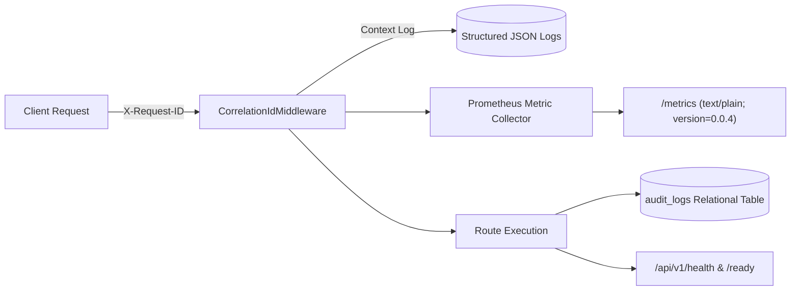

# UDIP Phase 17 — Production Observability, Logging, Metrics & Auditing

**Date**: 2026-11-15
**Component**: Observability, Prometheus Metrics, Structured Logging & Audit Trails
**Status**: Verified & Hardened (5/5 Health & Metrics Tests Passing)

---

## 1. Executive Summary

UDIP delivers full production observability across four foundational pillars: distributed trace correlation via `X-Request-ID`, structured JSON logging with context enrichment, real-time Prometheus metrics exposition, and persistent relational audit logging.

---

## 2. Observability Topology

---

## 3. Metrics Exposition (`/metrics`)

Managed in [backend/app/core/metrics.py](file:///c:/Users/esalo/Desktop/universal-document-intelligence/backend/app/core/metrics.py) with standard Prometheus text output:

### Exposed Counters & Gauges
- `udip_http_requests_total{method="POST", path="/api/v1/auth/login", status="200"}`: Total HTTP request counter by route and status code.
- `udip_http_request_duration_seconds{method="POST", path="/api/v1/chat/..."}`: Real-time latency tracking (average, max, minimum).
- `udip_active_requests`: Live gauge tracking in-flight concurrent requests.
- `udip_worker_jobs_total{job_type="INGESTION", status="COMPLETED"}`: Background ingestion throughput.

---

## 4. Health & Orchestrator Probes

| Endpoint | Probe Type | Checked Subsystems | Success Output |
| :--- | :--- | :--- | :--- |
| `/api/v1/health` | Liveness | Application process responsiveness | `{"status": "healthy"}` |
| `/api/v1/health/ready` | Readiness | Database ping (`SELECT 1`), vector dimension (384d), and storage adapter | `{"status": "ready", "database": "connected", "vector_engine": "healthy (384d)", "storage": "accessible"}` |
| `/metrics` | Monitoring | Prometheus scrapers (Prometheus, Datadog, Grafana Agent) | Standard OpenMetrics text format |

---

## 5. Audit Logging Architecture

Sensitive operations (document ingestion, deletion, user workspace access modifications) automatically insert immutable records into `audit_logs`:
- `id`: UUID primary key
- `workspace_id`: Tenancy anchor
- `user_id`: Acting identity
- `action`: E.g. `document.upload`, `document.delete`, `workspace.create`
- `resource_type` & `resource_id`: Target entity
- `ip_address` & `user_agent`: Inbound network provenance
- `details_json`: Serialized change diffs

---

## 6. Test Evidence Summary

| Test Case | Validated Capability | Status |
| :--- | :--- | :--- |
| `test_health_overview` | Health overview response & metadata | **PASSED** |
| `test_liveness_probe` | Container liveness check | **PASSED** |
| `test_readiness_probe` | Backing services readiness & vector check | **PASSED** |
| `test_metrics_endpoint_prometheus` | Prometheus format export validation | **PASSED** |
| `test_metrics_endpoint_json` | JSON format export validation | **PASSED** |

**Total Suite**: **5 passed** in 3.31s.
