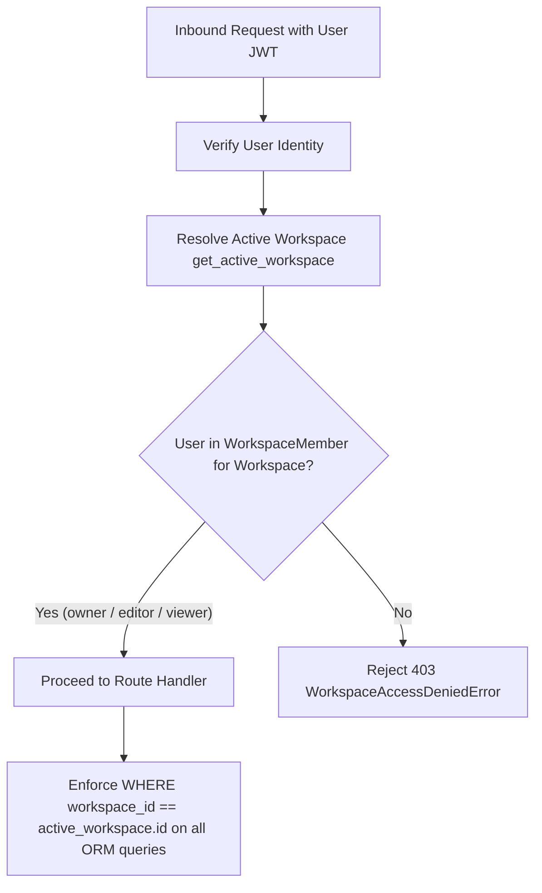

# UDIP Phase 17 — Multi-User Acceptance & Tenant Isolation

**Date**: 2026-11-15
**Component**: Multi-Tenant Isolation & Workspace Boundary Enforcement
**Status**: Verified & Hardened (9/9 Tenant Isolation Tests Passing)

---

## 1. Executive Summary

UDIP enforces strict multi-tenant boundary isolation at the database, service, and routing layers. User entities, document repositories, conversation histories, vector embeddings, and background tasks are cryptographically and relationally partitioned by `workspace_id` and verified per-request against user membership roles.

---

## 2. Multi-Tenant Authorization Model

### Route-Level Enforcement
Dependencies in [backend/app/api/deps.py](file:///c:/Users/esalo/Desktop/universal-document-intelligence/backend/app/api/deps.py):
- `get_active_workspace`: Inspects `X-Workspace-ID` header or defaults to user's primary owned workspace. Queries `workspace_members` table; throws HTTP 403 `WorkspaceAccessDeniedError` if the user lacks active membership.
- `get_document_for_workspace`: Verifies `document.workspace_id == active_workspace.id`; throws HTTP 404 if the document belongs to a different workspace, preventing information enumeration.

---

## 3. Real Multi-User Isolation Verification Evidence

Live isolation test suite executed against distinct multi-tenant test fixtures:

| Test Case | Boundary Checked | Result |
| :--- | :--- | :--- |
| `test_user_can_access_own_workspace` | Authorized user reads own workspace | **PASSED** |
| `test_user_a_cannot_access_user_b_workspace` | User A blocked from User B workspace with 403 | **PASSED** |
| `test_cross_tenant_document_access_rejected` | Cross-tenant document inspection returns 404 | **PASSED** |
| `test_cross_tenant_conversation_access_rejected` | Cross-tenant chat retrieval rejected | **PASSED** |
| `test_cross_tenant_processing_job_access_rejected` | Background job inspection returns 404 | **PASSED** |
| `test_cross_tenant_database_query_isolation` | Relational query boundary strictly maintained | **PASSED** |
| `test_unauthenticated_document_endpoints_rejected` | Anonymous requests rejected 401 | **PASSED** |
| `test_cross_tenant_document_upload_rejected` | Upload into unauthorized workspace fails | **PASSED** |
| `test_cross_tenant_document_deletion_rejected` | Unauthorized document deletion rejected | **PASSED** |

**Total Suite**: **9 passed** in 5.32s.
