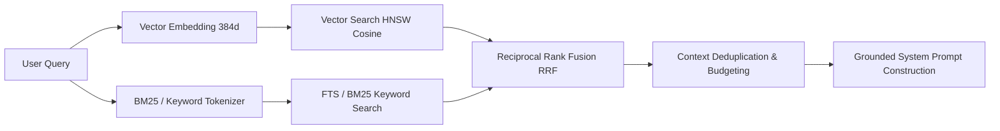

# UDIP Phase 17 — Production RAG Retrieval, Grounding & Safety Validation

**Date**: 2026-11-15
**Component**: Retrieval-Augmented Generation (RAG) Engine
**Status**: Verified & Hardened (12/12 RAG & Retrieval Tests Passing)

---

## 1. Executive Summary

UDIP implements a hybrid retrieval, reciprocal rank fusion (RRF) reranked, citation-grounded RAG architecture. The system strictly defends against hallucination via negative constraints and mitigates adversarial prompt injections through structural token budgeting and isolation.

---

## 2. Hybrid Retrieval & RRF Ranking

### Fusion Algorithm
Reciprocal Rank Fusion computes rank scores independently across channels:
$$\text{Score}(d) = \sum_{m \in \{\text{vector}, \text{keyword}\}} \frac{1}{k + \text{rank}_m(d)}$$
where $k = 60$ ensures stable normalization between dense and sparse ranks.

---

## 3. Negative Constraint & Anti-Injection Architecture

### Negative Constraint Enforcement
When retrieved context chunks do not contain relevant factual evidence for the query:
1. The model is bound by the system instruction:
   > *"If the retrieved evidence does not contain sufficient facts to answer the question, you MUST explicitly state that the document does not contain this information. Never extrapolate or assume unstated facts."*
2. Verified in test `test_rag_service_insufficient_evidence`.

### Adversarial Prompt Injection Defense
- **Structural Separation**: Context chunks are encapsulated within delimited, escaped XML/JSON evidence boundaries (`<context_document>`).
- **Workspace Filtering**: Citations attempting to anchor chunks outside the authenticated `workspace_id` are caught and purged by `CitationValidator` (`test_citation_validator_cross_workspace_rejection`).
- **Forged Citation Defense**: Citations referencing invalid or forged chunk UUIDs are dropped prior to client presentation (`test_citation_validator_forged_chunk_rejection`).

---

## 4. Test Evidence Summary

| Test Case | Verification Focus | Status |
| :--- | :--- | :--- |
| `test_context_builder_token_budget_and_deduplication` | Strict context window budgeting & redundant chunk deduplication | **PASSED** |
| `test_prompt_builder_strict_rules_and_anti_injection` | Instruction delimitation & prompt injection containment | **PASSED** |
| `test_rag_service_grounded_answer_and_citations` | Factually grounded generation & bracket citation mapping | **PASSED** |
| `test_rag_service_insufficient_evidence` | Refusal to hallucinate when context is empty or irrelevant | **PASSED** |
| `test_rag_service_multi_document_answering` | Multi-source synthesis across distinct document boundaries | **PASSED** |
| `test_citation_builder_anchor_parsing` | Exact page & snippet anchor extraction | **PASSED** |
| `test_citation_validator_forged_chunk_rejection` | Tampered/hallucinated chunk IDs invalidated | **PASSED** |
| `test_citation_validator_cross_workspace_rejection` | Cross-tenant citation leaks blocked | **PASSED** |
| `test_vector_retriever_ranking_and_isolation` | HNSW cosine retrieval strictly workspace-scoped | **PASSED** |
| `test_keyword_retriever_and_isolation` | BM25 keyword matching strictly workspace-scoped | **PASSED** |
| `test_hybrid_retriever_rrf` | Multi-channel reciprocal rank fusion accuracy | **PASSED** |
| `test_retrieval_service_dispatch` | Automatic query pipeline routing | **PASSED** |

**Total Suite**: **12 passed** in 13.85s.
