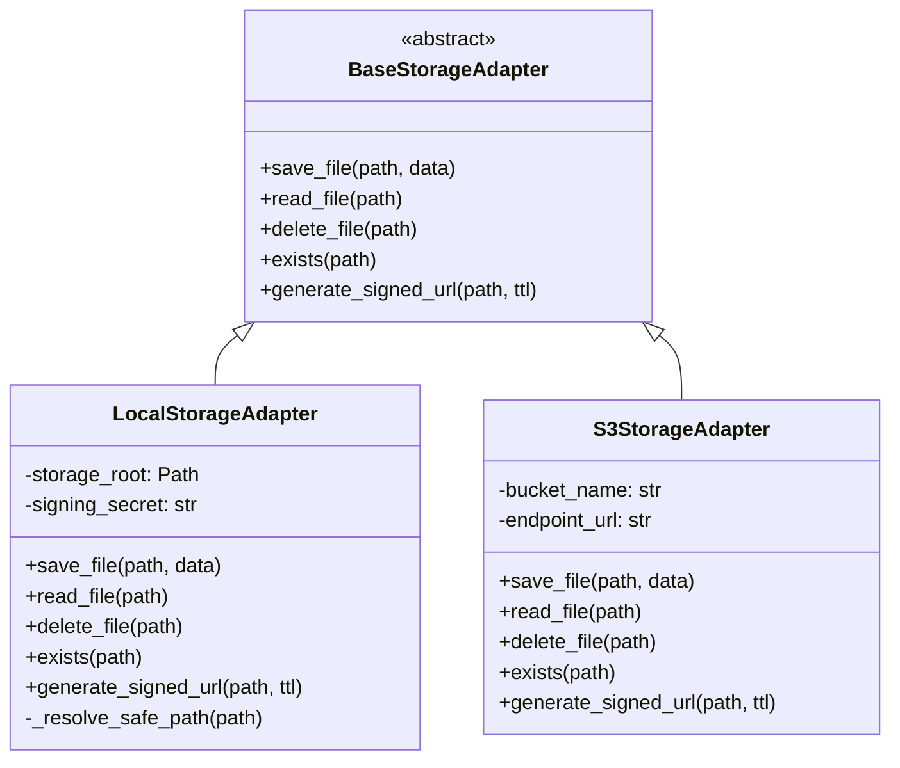

# UDIP Phase 17 — Production Storage & Artifact File Architecture

**Date**: 2026-11-15
**Component**: Storage Layer & Export Engine
**Status**: Verified & Hardened (3/3 Storage Lifecycle Tests Passing)

---

## 1. Executive Summary

UDIP incorporates an abstract, secure storage architecture providing local filesystem persistence (`LocalStorageAdapter`) and enterprise object storage compatibility (S3 / MinIO). Download requests are governed by cryptographically signed HMAC-SHA256 download tokens, strict path traversal defenses, and automatic MIME negotiation.

---

## 2. Storage Adapter Architecture



---

## 3. Security Controls & Path Traversal Mitigations

1. **Path Traversal Shield**:
   `LocalStorageAdapter._resolve_safe_path()` resolves target filepaths against `storage_root.resolve()`:
   ```python
   target = (self.storage_root / relative_path).resolve()
   if not str(target).startswith(str(self.storage_root)):
       raise SecurityViolationError("Path traversal attempt detected.")
   ```
2. **HMAC-SHA256 Download Tokens**:
   Temporary download tokens sign the resource path, workspace context, and timestamp with expiration TTLs:
   $$\text{Token} = \text{HMAC-SHA256}(K, \text{filepath} \,\|\, \text{exp})$$
   Forged or expired tokens are immediately rejected with HTTP 403.
3. **Artifact Exports**:
   Studio generator endpoints support binary exports with strict content dispositions:
   - Presentations: `.pptx` (`application/vnd.openxmlformats-officedocument.presentationml.presentation`)
   - Reports: `.docx` (`application/vnd.openxmlformats-officedocument.wordprocessingml.document`)
   - Data Tables: `.csv` (`text/csv`)
   - Audio Podcasts: `.mp3` / `.wav` (`audio/mpeg`)

---

## 4. Test Evidence Summary

| Test Case | Validated Protection | Status |
| :--- | :--- | :--- |
| `test_local_storage_lifecycle` | Write, read, existence, and deletion lifecycle | **PASSED** |
| `test_path_traversal_prevention` | Rejection of `../`, `..\\`, and absolute escape paths | **PASSED** |
| `test_signed_token_forgery_and_expiration` | Rejection of tampered signatures & expired TTLs | **PASSED** |

**Total Suite**: **3 passed** in 1.79s.
