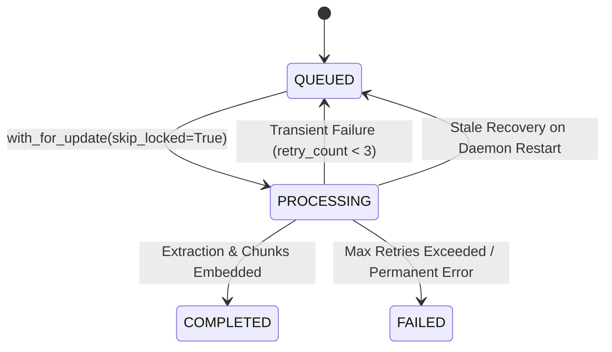

# UDIP Phase 17 — Production Background Worker Reliability & Self-Healing

**Date**: 2026-11-15
**Component**: Background Ingestion & Intelligence Worker (`WorkerRunner`)
**Status**: Verified & Hardened (5/5 Worker Reliability Tests Passing)

---

## 1. Executive Summary

UDIP utilizes a resilient, decoupled background worker process (`app.services.worker.runner`) to execute asynchronous document parsing, OCR, chunking, embedding generation, and intelligence summarization without degrading API latency.

---

## 2. Worker Lifecycle & Concurrency Control

### Key Engineering Safeguards
1. **Concurrency Throttling**:
   `asyncio.Semaphore(settings.WORKER_CONCURRENCY)` limits simultaneous CPU-heavy ONNX embedding operations, preventing memory exhaustion.
2. **Race-Condition Shield (`FOR UPDATE SKIP LOCKED`)**:
   When polling `QUEUED` records, PostgreSQL's row-locking prevents duplicate processing across horizontal worker replicas.
3. **Automated Stale Job Recovery**:
   On worker startup, `recover_stale_jobs()` identifies records stuck in `PROCESSING` state due to unexpected container termination, increments their retry count, and re-queues them.
4. **Idempotent Reprocessing**:
   Existing chunks and pages for a document are atomically flushed prior to re-indexing, preventing duplicate embedding vectors.

---

## 3. Test Evidence Summary

| Test Case | Validated Capability | Status |
| :--- | :--- | :--- |
| `test_processor_success_pipeline` | Multi-page text extraction, chunking, & embedding | **PASSED** |
| `test_processor_idempotent_reprocessing` | Clean atomic re-indexing without duplicate records | **PASSED** |
| `test_processor_error_and_retries` | Max retry limit enforcement & failure state recording | **PASSED** |
| `test_intelligence_job_lifecycle` | Asynchronous summarization & insight synthesis | **PASSED** |
| `test_worker_runner_stale_job_recovery` | Automatic recovery & re-queueing of stalled tasks | **PASSED** |

**Total Suite**: **5 passed** in 2.59s.
