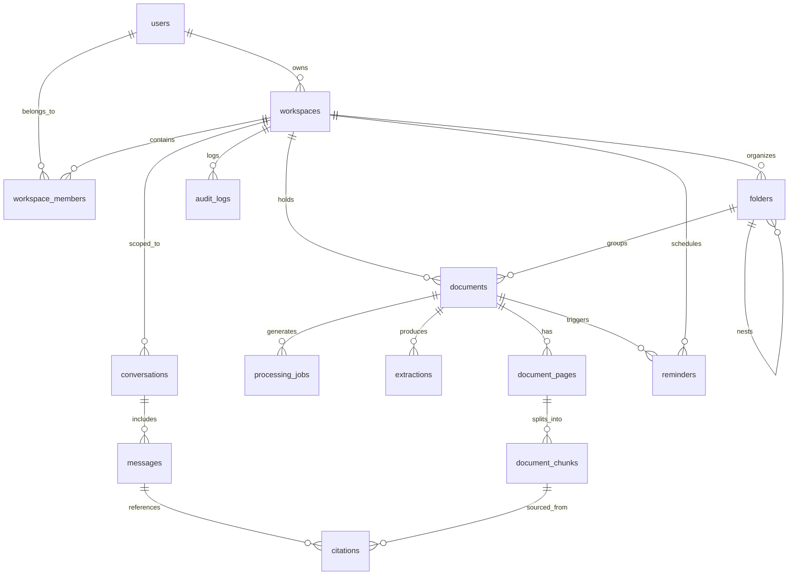

# UDIP Database Schema & Vector Storage Specification

## 1. Overview & Technology Selection

The **Universal Document Intelligence Platform (UDIP)** uses **PostgreSQL 16** with the **pgvector** extension. 
All data models are fully normalized to Third Normal Form (3NF) to guarantee transactional integrity, multi-tenant workspace isolation, and high-performance hybrid vector/keyword querying.

### 1.1 Vector Storage Specifications
- **Dimension**: 384 dimensions (aligned with `sentence-transformers/all-MiniLM-L6-v2`).
- **Metric**: Cosine Distance (`vector_cosine_ops`, operator `<=>`).
- **Index Type**: **HNSW (Hierarchical Navigable Small World)** for sub-millisecond retrieval on CPU:
  - `m = 16` (number of bi-directional links per element)
  - `ef_construction = 64` (size of the dynamic candidate list during index build)
- **Full-Text Index**: PostgreSQL `tsvector` with **GIN (Generalized Inverted Index)** for sparse keyword search.

---

## 2. Entity-Relationship Diagram



---

## 3. Normalized Table Definitions

### 3.1 `users`
Stores user profile information synced with Supabase Auth or local authentication.
```sql
CREATE TABLE users (
    id UUID PRIMARY KEY DEFAULT gen_random_uuid(),
    email VARCHAR(255) NOT NULL UNIQUE,
    full_name VARCHAR(150),
    avatar_url TEXT,
    role VARCHAR(50) NOT NULL DEFAULT 'user', -- 'user', 'admin'
    is_active BOOLEAN NOT NULL DEFAULT TRUE,
    created_at TIMESTAMPTZ NOT NULL DEFAULT CURRENT_TIMESTAMP,
    updated_at TIMESTAMPTZ NOT NULL DEFAULT CURRENT_TIMESTAMP
);
CREATE INDEX idx_users_email ON users(email);
```

### 3.2 `workspaces`
Represents an isolated personal or team workspace for documents and conversations.
```sql
CREATE TABLE workspaces (
    id UUID PRIMARY KEY DEFAULT gen_random_uuid(),
    name VARCHAR(100) NOT NULL,
    slug VARCHAR(120) NOT NULL UNIQUE,
    owner_id UUID NOT NULL REFERENCES users(id) ON DELETE RESTRICT,
    settings JSONB NOT NULL DEFAULT '{}'::jsonb,
    created_at TIMESTAMPTZ NOT NULL DEFAULT CURRENT_TIMESTAMP,
    updated_at TIMESTAMPTZ NOT NULL DEFAULT CURRENT_TIMESTAMP
);
CREATE INDEX idx_workspaces_owner ON workspaces(owner_id);
```

### 3.3 `workspace_members`
Association table for workspace authorization and multi-tenant access control.
```sql
CREATE TABLE workspace_members (
    id UUID PRIMARY KEY DEFAULT gen_random_uuid(),
    workspace_id UUID NOT NULL REFERENCES workspaces(id) ON DELETE CASCADE,
    user_id UUID NOT NULL REFERENCES users(id) ON DELETE CASCADE,
    role VARCHAR(50) NOT NULL DEFAULT 'member', -- 'owner', 'admin', 'member', 'viewer'
    created_at TIMESTAMPTZ NOT NULL DEFAULT CURRENT_TIMESTAMP,
    CONSTRAINT uq_workspace_user UNIQUE (workspace_id, user_id)
);
CREATE INDEX idx_workspace_members_user ON workspace_members(user_id);
```

### 3.4 `folders`
Hierarchical folders for organizing documents within a workspace.
```sql
CREATE TABLE folders (
    id UUID PRIMARY KEY DEFAULT gen_random_uuid(),
    workspace_id UUID NOT NULL REFERENCES workspaces(id) ON DELETE CASCADE,
    parent_id UUID REFERENCES folders(id) ON DELETE CASCADE,
    name VARCHAR(150) NOT NULL,
    color VARCHAR(7) DEFAULT '#4F46E5',
    created_at TIMESTAMPTZ NOT NULL DEFAULT CURRENT_TIMESTAMP,
    updated_at TIMESTAMPTZ NOT NULL DEFAULT CURRENT_TIMESTAMP,
    CONSTRAINT uq_folder_name_in_parent UNIQUE (workspace_id, parent_id, name)
);
CREATE INDEX idx_folders_workspace ON folders(workspace_id);
```

### 3.5 `documents`
Master record for uploaded files. Maintains file identity, size, processing status, and metadata.
```sql
CREATE TABLE documents (
    id UUID PRIMARY KEY DEFAULT gen_random_uuid(),
    workspace_id UUID NOT NULL REFERENCES workspaces(id) ON DELETE CASCADE,
    folder_id UUID REFERENCES folders(id) ON DELETE SET NULL,
    user_id UUID NOT NULL REFERENCES users(id) ON DELETE RESTRICT,
    title VARCHAR(255) NOT NULL,
    filename VARCHAR(255) NOT NULL,
    file_path TEXT NOT NULL,
    file_size_bytes BIGINT NOT NULL,
    mime_type VARCHAR(100) NOT NULL,
    file_hash VARCHAR(64) NOT NULL, -- SHA-256 for deduplication
    page_count INTEGER DEFAULT 0,
    status VARCHAR(50) NOT NULL DEFAULT 'PENDING', -- 'PENDING', 'PROCESSING', 'READY', 'FAILED'
    processing_error TEXT,
    metadata JSONB NOT NULL DEFAULT '{}'::jsonb,
    is_deleted BOOLEAN NOT NULL DEFAULT FALSE,
    created_at TIMESTAMPTZ NOT NULL DEFAULT CURRENT_TIMESTAMP,
    updated_at TIMESTAMPTZ NOT NULL DEFAULT CURRENT_TIMESTAMP
);
CREATE INDEX idx_documents_workspace ON documents(workspace_id) WHERE is_deleted = FALSE;
CREATE INDEX idx_documents_hash ON documents(workspace_id, file_hash);
CREATE INDEX idx_documents_status ON documents(status);
```

### 3.6 `document_pages`
Stores page-level content, preserving canonical page boundaries and OCR metadata.
```sql
CREATE TABLE document_pages (
    id UUID PRIMARY KEY DEFAULT gen_random_uuid(),
    document_id UUID NOT NULL REFERENCES documents(id) ON DELETE CASCADE,
    page_number INTEGER NOT NULL,
    content TEXT NOT NULL,
    token_count INTEGER NOT NULL DEFAULT 0,
    has_images BOOLEAN NOT NULL DEFAULT FALSE,
    ocr_applied BOOLEAN NOT NULL DEFAULT FALSE,
    metadata JSONB NOT NULL DEFAULT '{}'::jsonb,
    created_at TIMESTAMPTZ NOT NULL DEFAULT CURRENT_TIMESTAMP,
    CONSTRAINT uq_doc_page UNIQUE (document_id, page_number)
);
CREATE INDEX idx_document_pages_doc ON document_pages(document_id);
```

### 3.7 `document_chunks`
Stores chunked passages with 384-dimensional pgvector embeddings and full-text search tsvectors.
```sql
CREATE TABLE document_chunks (
    id UUID PRIMARY KEY DEFAULT gen_random_uuid(),
    document_id UUID NOT NULL REFERENCES documents(id) ON DELETE CASCADE,
    page_id UUID NOT NULL REFERENCES document_pages(id) ON DELETE CASCADE,
    chunk_index INTEGER NOT NULL,
    content TEXT NOT NULL,
    token_count INTEGER NOT NULL,
    embedding vector(384) NOT NULL,
    search_vector tsvector GENERATED ALWAYS AS (to_tsvector('english', content)) STORED,
    metadata JSONB NOT NULL DEFAULT '{}'::jsonb,
    created_at TIMESTAMPTZ NOT NULL DEFAULT CURRENT_TIMESTAMP
);
-- HNSW Vector Index for Cosine Similarity
CREATE INDEX idx_chunks_embedding_hnsw 
    ON document_chunks 
    USING hnsw (embedding vector_cosine_ops) 
    WITH (m = 16, ef_construction = 64);

-- GIN Index for Hybrid Full-Text Search
CREATE INDEX idx_chunks_search_vector 
    ON document_chunks 
    USING gin (search_vector);

CREATE INDEX idx_chunks_document ON document_chunks(document_id);
```

### 3.8 `processing_jobs`
Tracks asynchronous ingestion jobs, retry states, and diagnostic details.
```sql
CREATE TABLE processing_jobs (
    id UUID PRIMARY KEY DEFAULT gen_random_uuid(),
    workspace_id UUID NOT NULL REFERENCES workspaces(id) ON DELETE CASCADE,
    document_id UUID NOT NULL REFERENCES documents(id) ON DELETE CASCADE,
    job_type VARCHAR(50) NOT NULL DEFAULT 'FULL_INGESTION',
    status VARCHAR(50) NOT NULL DEFAULT 'QUEUED', -- 'QUEUED', 'PROCESSING', 'COMPLETED', 'FAILED'
    progress_percentage INTEGER NOT NULL DEFAULT 0,
    retry_count INTEGER NOT NULL DEFAULT 0,
    error_message TEXT,
    started_at TIMESTAMPTZ,
    completed_at TIMESTAMPTZ,
    created_at TIMESTAMPTZ NOT NULL DEFAULT CURRENT_TIMESTAMP
);
CREATE INDEX idx_jobs_status ON processing_jobs(status);
CREATE INDEX idx_jobs_doc ON processing_jobs(document_id);
```

### 3.9 `conversations`
Maintains conversational context across one or multiple documents.
```sql
CREATE TABLE conversations (
    id UUID PRIMARY KEY DEFAULT gen_random_uuid(),
    workspace_id UUID NOT NULL REFERENCES workspaces(id) ON DELETE CASCADE,
    user_id UUID NOT NULL REFERENCES users(id) ON DELETE CASCADE,
    title VARCHAR(255) NOT NULL DEFAULT 'New Conversation',
    active_document_ids UUID[] NOT NULL DEFAULT '{}',
    created_at TIMESTAMPTZ NOT NULL DEFAULT CURRENT_TIMESTAMP,
    updated_at TIMESTAMPTZ NOT NULL DEFAULT CURRENT_TIMESTAMP
);
CREATE INDEX idx_conversations_workspace ON conversations(workspace_id);
```

### 3.10 `messages`
Stores individual conversation turns between user and AI assistant.
```sql
CREATE TABLE messages (
    id UUID PRIMARY KEY DEFAULT gen_random_uuid(),
    conversation_id UUID NOT NULL REFERENCES conversations(id) ON DELETE CASCADE,
    sender_type VARCHAR(20) NOT NULL, -- 'user', 'assistant', 'system'
    content TEXT NOT NULL,
    token_count INTEGER DEFAULT 0,
    created_at TIMESTAMPTZ NOT NULL DEFAULT CURRENT_TIMESTAMP
);
CREATE INDEX idx_messages_conversation ON messages(conversation_id);
```

### 3.11 `citations`
Strictly tracks evidence chunks cited by assistant messages.
```sql
CREATE TABLE citations (
    id UUID PRIMARY KEY DEFAULT gen_random_uuid(),
    message_id UUID NOT NULL REFERENCES messages(id) ON DELETE CASCADE,
    chunk_id UUID NOT NULL REFERENCES document_chunks(id) ON DELETE CASCADE,
    document_id UUID NOT NULL REFERENCES documents(id) ON DELETE CASCADE,
    page_number INTEGER NOT NULL,
    quote TEXT NOT NULL,
    relevance_score FLOAT,
    created_at TIMESTAMPTZ NOT NULL DEFAULT CURRENT_TIMESTAMP
);
CREATE INDEX idx_citations_message ON citations(message_id);
```

### 3.12 `extractions`
Stores structured data extracted from documents based on user-defined or prebuilt schemas.
```sql
CREATE TABLE extractions (
    id UUID PRIMARY KEY DEFAULT gen_random_uuid(),
    workspace_id UUID NOT NULL REFERENCES workspaces(id) ON DELETE CASCADE,
    document_id UUID NOT NULL REFERENCES documents(id) ON DELETE CASCADE,
    extraction_type VARCHAR(100) NOT NULL, -- e.g. 'invoice', 'contract_terms', 'financial_table'
    schema_definition JSONB NOT NULL,
    extracted_data JSONB NOT NULL,
    confidence_score FLOAT,
    status VARCHAR(50) NOT NULL DEFAULT 'COMPLETED',
    created_at TIMESTAMPTZ NOT NULL DEFAULT CURRENT_TIMESTAMP
);
CREATE INDEX idx_extractions_document ON extractions(document_id);
```

### 3.13 `reminders`
Stores important extracted dates, renewal obligations, and deadlines with user confirmation.
```sql
CREATE TABLE reminders (
    id UUID PRIMARY KEY DEFAULT gen_random_uuid(),
    workspace_id UUID NOT NULL REFERENCES workspaces(id) ON DELETE CASCADE,
    document_id UUID REFERENCES documents(id) ON DELETE SET NULL,
    user_id UUID NOT NULL REFERENCES users(id) ON DELETE CASCADE,
    title VARCHAR(255) NOT NULL,
    description TEXT,
    due_date TIMESTAMPTZ NOT NULL,
    is_confirmed BOOLEAN NOT NULL DEFAULT FALSE,
    is_dismissed BOOLEAN NOT NULL DEFAULT FALSE,
    metadata JSONB NOT NULL DEFAULT '{}'::jsonb,
    created_at TIMESTAMPTZ NOT NULL DEFAULT CURRENT_TIMESTAMP
);
CREATE INDEX idx_reminders_user_due ON reminders(user_id, due_date) WHERE is_dismissed = FALSE;
```

### 3.14 `audit_logs`
Immutable security and compliance log recording document access, export, and deletion actions.
```sql
CREATE TABLE audit_logs (
    id UUID PRIMARY KEY DEFAULT gen_random_uuid(),
    workspace_id UUID NOT NULL REFERENCES workspaces(id) ON DELETE CASCADE,
    user_id UUID REFERENCES users(id) ON DELETE SET NULL,
    action VARCHAR(100) NOT NULL, -- 'DOCUMENT_UPLOAD', 'DOCUMENT_DOWNLOAD', 'DOCUMENT_DELETE', 'QUERY'
    resource_type VARCHAR(50) NOT NULL,
    resource_id UUID NOT NULL,
    details JSONB NOT NULL DEFAULT '{}'::jsonb,
    ip_address VARCHAR(45),
    created_at TIMESTAMPTZ NOT NULL DEFAULT CURRENT_TIMESTAMP
);
CREATE INDEX idx_audit_logs_workspace ON audit_logs(workspace_id, created_at DESC);
```

---

## 4. Database Migrations (Alembic)

Database schema updates are managed through version-controlled Alembic migrations:
- Synchronous driver `psycopg` used for running DDL migrations.
- Async driver `asyncpg` used for high-concurrency runtime queries.
- Migration files reside in `backend/alembic/versions/` with explicit rollback (`downgrade()`) steps.
- The `vector` extension is created in the initial migration via `CREATE EXTENSION IF NOT EXISTS vector;`.
